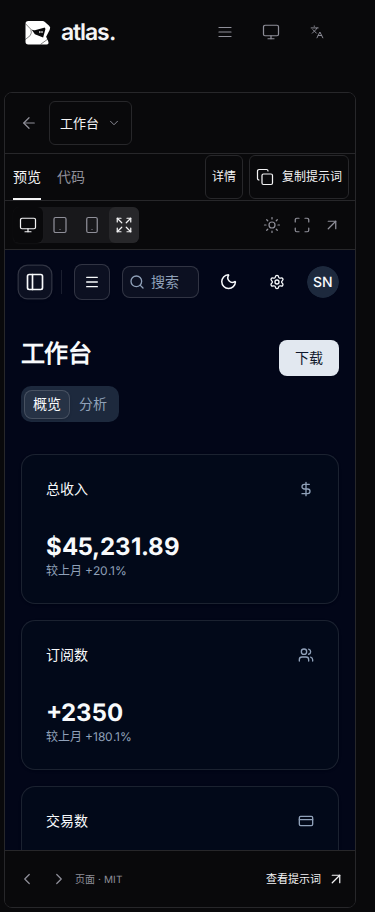
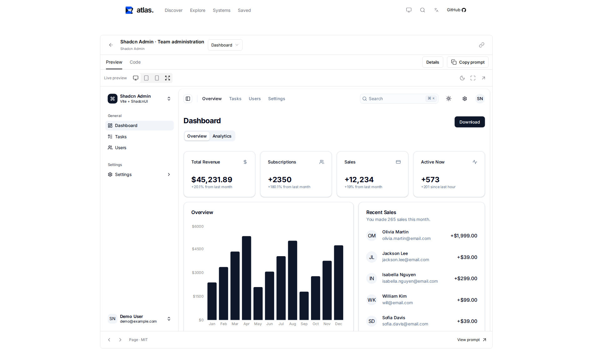

# 目录、交付、筛选与预览验收

本页保留此前阶段的验收快照；当前详情查看器的窗口适配规则见[后续修复](../ui/viewport-fit/README.md)，其中的手机最低画布高度和短屏外层滚动不再适用。

本轮基线为 `782cee73a520932cff49878197592b5897569f51`。没有升级依赖，保留 97 个资源 ID、`type:id` 收藏键及版本 1 备份格式。

## 实测结果

| 检查                              | 改动前                                    | 改动后                        |
| --------------------------------- | ----------------------------------------- | ----------------------------- |
| 主文档启动脚本 gzip 合计          | 223,001 字节                              | 186,887 字节（预算 190,000）  |
| 发现页追加 24 项：原有可见 iframe | 2 个，均被替换                            | 2 个，全部保留                |
| 同一追加操作新增 iframe 文档请求  | 2                                         | 0                             |
| 原有文档及输入状态                | 丢失                                      | 保留                          |
| 375×812 窗口中的自动预览          | 原生 375×812，显示约 231×500，scale 0.616 | 原生及显示均 350×812，scale 1 |

启动体积使用同一 esbuild 0.28.2、生产选项及 Node gzip 默认值，汇总所有立即静态导入的脚本；不是只测入口。浏览器网络测试另行记录主文档和 iframe 脚本。发现页对比使用相同 Chromium、1440×1000 窗口，程序激活“继续浏览”以保持旧卡片持续可见，直接计数导航请求、挂载数、iframe 和文档身份及输入值。

数据见 [体积基线](budget-before.json)、[体积结果](budget-after.json)、[浏览器网络](network-budget.json)、[预览对比](preview-comparison.json)、[追加保留测试](discovery-retention.json) 和 [响应式尺寸](responsive-metrics.json)。

## 已执行验证

- `npm run verify`：严格类型检查、目录/许可/上游校验、11 项单元测试、生产构建、110 项 Playwright 测试、1 项隔离开发环境综合测试全部通过。Chromium 104 项；Firefox、WebKit 各 3 项，执行筛选、导航、收藏、源码和预览核心流程。
- 在隔离副本中修改主站 CSS/JS、两个 React 示例和目录；实际新增、删除资源，验证名称、搜索、详情、源码索引和 ZIP 一致；非法目录及编译错误修复后恢复，退出后端口释放。
- 文件清单和 ZIP 排除无敏感信息的环境文件、日志、备份、无关本地源码；越界链接被拒绝。校验覆盖重复键、非法枚举、缺失引用和依赖闭合。
- 四个原创案例 ZIP 分别在仓库外解压，由普通静态服务器运行，验证页面跳转、中英文、明暗主题、表单提交、设置保存及购物袋交互。两个 React 完整项目 ZIP 在仓库外使用与锁文件匹配的已安装依赖完成构建。
- 375、768、1440、1910px，包含矮窗口，中英文、明暗主题的预览和筛选流程均实测并保存截图；桌面限宽、手机 scale 1、手动设备模拟、全屏、详情栏、重试和最多 8 个活动预览有回归测试。
- 组合输入、旧式 IME 键码、防抖和输入后立即导航有浏览器事件测试。当前环境没有执行真实中文输入法的人工验证。

本地 WebKit 使用临时补齐的 Ubuntu 运行库完成实测；其系统依赖探测只查询系统缓存，本地执行时跳过该探测。浏览器和流程测试没有跳过。CI 通过 `playwright install --with-deps chromium firefox webkit` 正常安装依赖并运行相同 `verify`。

## 独立审核修复

独立审核初稿提交 `7885ae5` 后确认并修复两项问题：

- 首次源码工具模块请求失败时显示错误和重新加载入口。浏览器会缓存失败的模块导入，因此通过保留当前 URL 的页面重新加载恢复；源码数据请求仍可原位重试。三个浏览器均验证断网恢复后真正显示源码，以及延迟模块请求不会覆盖新的资源页面。
- 空查询分类分组与关键词结果分组切换时，先按资源键迁移保留卡片，再释放旧分组。单个收藏表单在输入和清空关键词往返中保留 iframe、文档和输入值，新增文档请求为零。

最终独立复核与 CI 结论记录在 PR 中。

首轮 CI 的生产与 103 项浏览器测试通过，开发测试在越界链接删除后的全量 ZIP 重建处超过默认 5 秒等待。该生成/恢复断言采用 20 秒窗口，仍要求实际返回 500 后恢复 200；同时隔离副本复制字体资源、独立保存示例的 Vite 缓存，并断言字体实际加载，避免依赖符号链接超出 Vite 服务边界。修改后的开发验收在限制为两个 CPU 核心的环境中通过。

## 视觉记录

手机预览使用实际可用宽度，短屏滚动外层页面，长演示内容在 iframe 内滚动：

宽屏预览保持居中限宽和原始画布比例：

全部截图及浏览器报告由 CI 保存为 `atlas-acceptance` 产物。独立 PR 审核及 CI 状态以 PR 为准，此文档记录本地验收。
