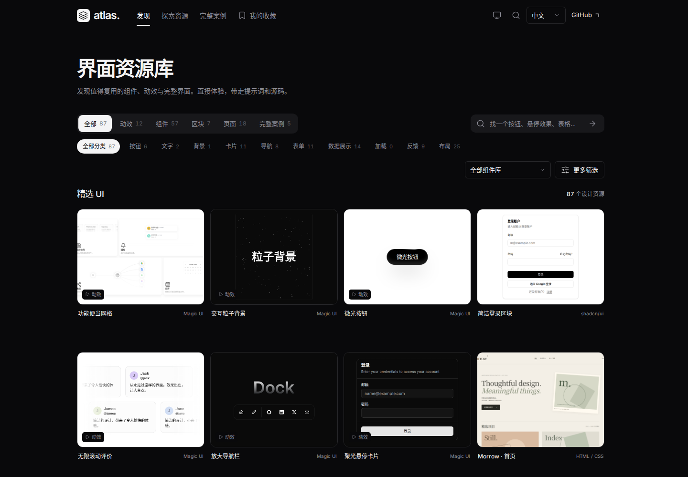
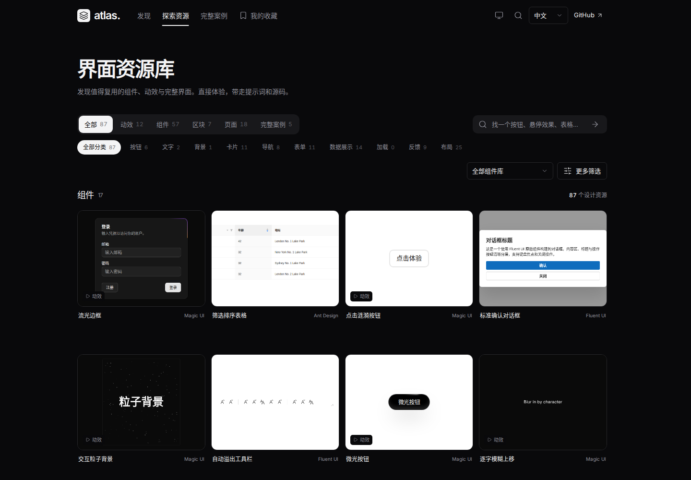
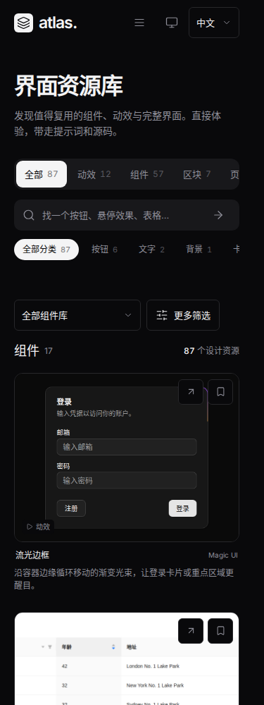

# 浏览切换布局稳定性验收

关联 Issue #5 的后续修复。此前修复保留了液态选中标记和按钮尺寸，但发现页与列表页仍使用不同布局。本轮统一浏览框架，覆盖整个筛选区与首行卡片的位置。

## 复现与原因

在合并后的 `ced8682` 上，1440 × 1000、中文环境中，从发现页进入探索资源页：

| 区域 | 发现页 | 探索资源页 | 变化 |
| --- | --- | --- | --- |
| 类型栏顶部 | 280.31px | 238.30px | 上移约 42px |
| 搜索框左侧 | 984.5px | 643.5px | 左移 341px |
| 首张卡片顶部 | 408.31px | 527.30px | 下移约 119px |

两页分别维护标题、分类栏和搜索工具栏；列表搜索框继承了 `margin-right: auto`，额外筛选、已选标签、资源总数和分组标题又分别占行。仅保持按钮尺寸无法防止跨页跳动。

## 修改范围

- 发现与列表共用标题、类型导航、搜索、用途分类和筛选表单。普通浏览视图统一使用“界面资源库”标题；收藏和合集保留专有标题。
- 首页仍展示精选资源，搜索提交或选择筛选条件后进入探索结果；组件库和更多筛选在两页保持相同位置。
- 条件标签与辅助筛选共用稳定行，长条件横向滚动；组件库选择框保持固定宽度，选中较长名称时相邻控件不再位移。
- 总数与分组标题在同一行；保留组件、区块、页面、完整案例的原有分组和不同卡片比例。
- 更多筛选的展开状态随浏览切换保留；显式展开/收起仍会按内容自然改变高度。
- 保留连续选中动画、键盘焦点、搜索排序、真实预览、源码交付和历史导航。

## 验证方法

`tests/browse-layout.spec.mjs` 比较真实 DOM 坐标，覆盖中英文、2560/1440/768/375px：发现与探索顶栏导航、全部资源类型、分类选择与清除、前进后退；另覆盖首页搜索提交、组件库选择、长条件和更多筛选展开状态。原有动画测试继续逐帧检查选中标记与文字位置。

截图来自本地正式构建的 `/ui-design-atlas/` 子路径。验证范围为浏览框架；改变筛选结果或资源类型时，卡片内容、数量和组件/页面比例会按原有规则改变。

最终验证结果：

- `npm run check`：通过，包含 5 项单元测试。
- `npm run build`：通过；收录演示保留原有的大包体积提示。
- `npm test`：52 项 Playwright 测试全部通过（约 1.7 分钟）。
- Prettier 和 `git diff --check`：通过。

## 修复后测量

[原始坐标记录](browse-layout/metrics.json)：1440px 下，两页类型栏顶部均为 238.30px、搜索框左侧均为 984.5px、首张卡片顶部均为 438.30px；375px 下首张卡片顶部均为 528.80px。跨页位置差为 0px。

## 截图

| 场景 | 发现页 | 探索资源页 |
| --- | --- | --- |
| 桌面深色 |  |  |
| 手机深色 |  |  |
