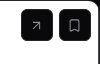
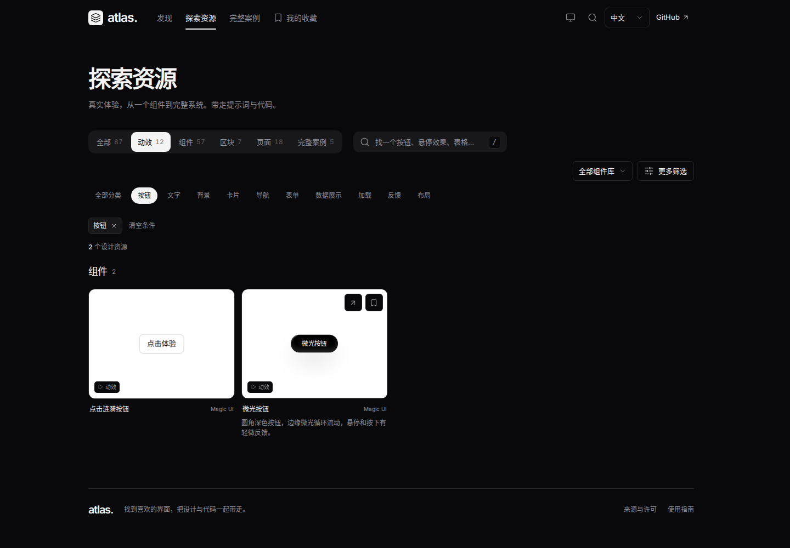

# 资源卡片：预览、说明与右上角操作

关联 [Issue #7](https://github.com/Xiiiing/ui-design-atlas/issues/7)，作为 [PR #6](https://github.com/Xiiiing/ui-design-atlas/pull/6) 的补充修复。前置提交为 `6a42c3e`。

## 已复现的问题

`#motion?lang=zh-CN&category=buttons` 中悬停“微光按钮”时，说明文字在预览内部绝对定位，层级高于动效标签。深色模式下出现整块黑色说明区，遮住白色画布底部与动效标签。1440px 下，预览底部为 727.546875px，说明从 669.546875px 开始，标签位于 695.546875～716.546875px，因此完全被说明区覆盖。

右上角另有独立问题：打开入口缺少与收藏共用的图标按钮样式，箭头水平中心偏左 7.5px。通过浏览器坐标断言已先复现该偏差；补齐共用样式后，打开和收藏图标的水平、垂直中心偏差均为 0px。

## 修改结果

卡片统一采用“预览 → 名称与组件库 → 简短说明”的顺序。说明移至画布外，保留两行高度，桌面悬停或聚焦时显现，手机与无悬停设备常驻。完整案例的简介常驻，复用同一份说明，避免重复。

预览的封面、实时演示、点击入口和动效标签仍共享原画布。移除旧手机布局为内部说明补偿的固定图片高度与标签偏移。未修改上游演示、取景规格、资源 ID 或主题。右上角打开入口复用现有 `icon-button` 样式，与收藏保持相同居中、颜色和交互反馈；桌面均为 32px 方形，手机均为 36px，原有间距和边距保留。

## 验证与证据

- `npm run check`、`npm run build`、完整 `npm test`（44 项）通过。构建仍有已有演示的 chunk 体积提示。
- 新增测试覆盖中英文、明暗模式及 1440/768/375px，检查说明位于画布与标题下方，悬停、聚焦和实时加载前后几何相同；验证相邻行稳定、宽区块、触控打开与焦点恢复。
- 新增右上角回归覆盖 1440/768/375px 与明暗模式，验证两个图标居中、同尺寸、同顶部和独立点击区域；收藏切换不误开预览，打开入口可正常体验资源，关闭后焦点回到对应卡片。
- 现有回归继续检查悬停预览最多两个、离屏卸载、封面/实时画布一致、首页两行资源和移动端标签位置。
- [截图与坐标](./card-preview/verification.json) 记录构建文件 SHA-256。截图采集拦截外部来源请求，未出现页面错误或横向溢出。
- [交互录屏](./card-preview/interaction.webm) 包含悬停加载、键盘聚焦、打开预览和关闭后的焦点恢复。

[平板浅色](./card-preview/motion-768-light-en.png) · [手机深色](./card-preview/motion-375-dark-zh-CN.png) · [宽区块](./card-preview/blocks-1440-light-en.png) · [键盘焦点](./card-preview/keyboard-focus.png)

复现：构建后启动 `node scripts/serve.mjs --dist --base=/ui-design-atlas/`，运行 `node scripts/capture-card-preview.mjs`。

仅更新 PR，未合并或发布。
