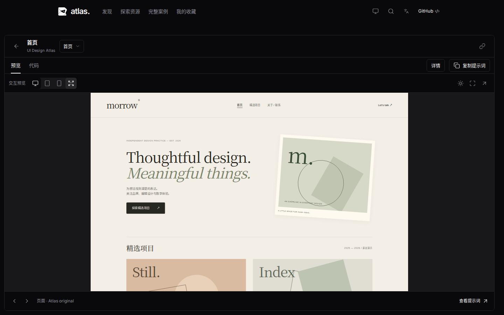
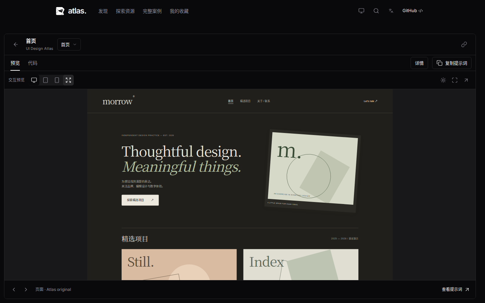
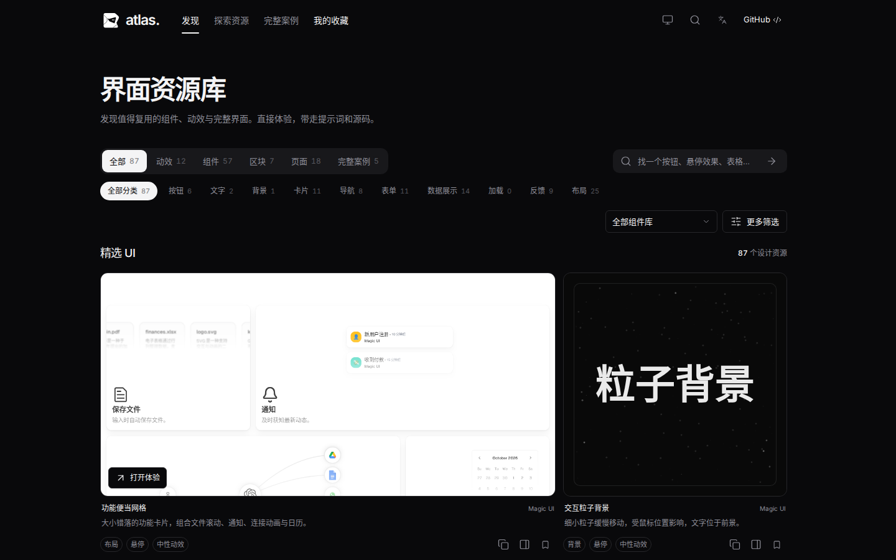
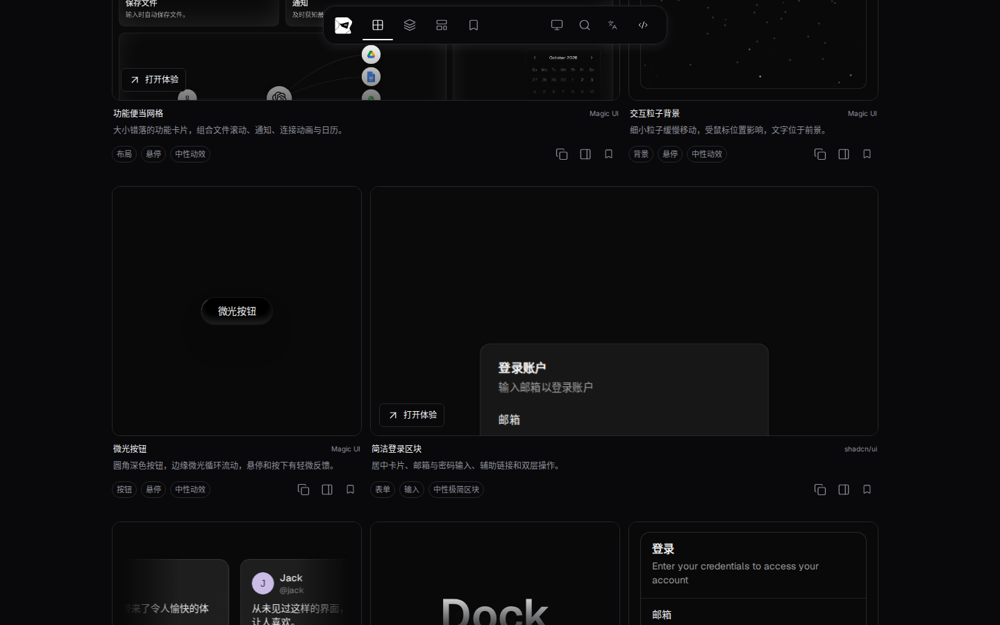
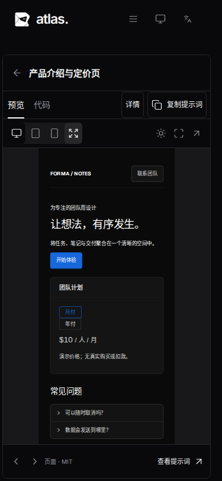

# 主题一致性、导航连续性与资源扩充

关联 Issue #25。基线为 PR #24 合入后的 `7209de8`。

## 交互与布局

- 顶部主导航重复点击当前栏目保留原位置；切换到首次访问的栏目延续当前滚动位置，返回已访问栏目恢复其筛选条件、已加载数量与滚动位置。浏览器前进/后退保留对应历史条目。详情返回恢复入口卡片焦点；主导航切换则把焦点保留在导航项。目标内容不足一屏时，滚动位置自然限制在该页面可滚动范围内。
- 原创 Folio、Orbit、Forma、Bloom 的页面和组件接入站点主题；语义化背景、文字、表面随明暗变化，保留品牌强调色与插画。站点处于系统模式时响应操作系统变化；体验页支持局部主题覆盖，下次站点主题变化重新同步。独立打开且没有 theme 参数时默认跟随系统。
- 全部 97 个资源生成亮色/暗色封面。主题变化仅替换封面与通知实时演示，不重建卡片或清除输入。
- 桌面浏览工具区、展开说明的体验页主次区域、新增页面的主体与辅助区按约 `1.618:1` 分配。介绍文字限制阅读宽度，正文使用 `1.618` 行高。保留 1×1 / 2×1 卡片网格、原始演示长宽比和窄屏单列；不将按钮或设备视口强制拉成黄金矩形。

## 新增 10 项（87 → 97）

| 类型 | 资源 | 实际操作 |
| --- | --- | --- |
| 实用组件 | 本地文件选择 | 多选、5MB 校验、五文件上限、移除 |
| 实用组件 | 分步设置 | 必填校验、确认、返回、完成、重新设置 |
| 实用组件 | 快捷文档搜索 | 关键词过滤、键盘选择、清除、无匹配状态 |
| 实用组件 | 可恢复状态反馈 | 保存、模拟失败、重试 |
| 动效 | 轮换文字 | 暂停/播放、减少动态效果时静态显示 |
| 动效 | 流光轮廓卡片 | 可切换收藏状态、装饰层不截获点击 |
| 动效 | 流星背景 | 暂停/播放、减少动态效果时移除背景动效 |
| 页面 | 团队文件空间 | 搜索、移除、恢复列表、本地附件选择 |
| 页面 | 工作区引导页 | 完整两步设置流程 |
| 页面 | 产品介绍与定价 | 价格切换、FAQ、联系弹窗与邮箱校验 |

七个 Atlas 组合使用现有 Ant Design 依赖，明确标注原创来源和 MIT 许可。三个动效保留 Magic UI 固定版本的原文件与校验和，新增本地语言、交互及 CSS 动画适配。无新增依赖或版本升级。

所有新增资源附带中英文资源提示词、用途/交互/风格标签、明暗封面、来源与许可（源码链接固定至实现 commit）、资源级依赖闭包和可运行项目下载。文件和表单仅演示本地状态。

## 验证与复现

最终结果：`npm run check` 通过（5 项单元测试），`npm run build` 通过，完整 `npm test` **83 项通过**。真实录屏覆盖主题覆盖、导航保位、错误重试与产品表单；共 16 张截图，捕获过程无页面异常。构建保留原有 chunk 大小提示。

```sh
npm run check
npm run build
npm test
# 如需生成双主题封面（完成后重新 build）：
npm run capture:previews
# 当前版本截图及真实交互录屏：
node scripts/capture-cohesive-experience.mjs
# 可选：通过独立端口提供基线构建，捕获同场景前后对比：
ATLAS_BEFORE_URL=http://127.0.0.1:4189/ui-design-atlas/ node scripts/capture-cohesive-experience.mjs
```

- `tests/cohesive-experience.spec.mjs` 覆盖原创主题同步/覆盖、独立跟随系统、导航记忆与历史、封面几何稳定、新增真实操作、减少动态效果、手机中英文/主题和文件校验。
- 原有完整回归继续覆盖卡片内交互、复制失败恢复、组合标签、源码依赖闭包、主题早期就绪、触屏滚动、首张卡片/筛选栏位置稳定、原比例最大化和详情/全屏。
- 旧测试中页面数、动效数改为按目录统计；主导航测试从“点击后回顶”改为“保持位置，主动滚回顶部再展开”。未放宽几何或交互要求。
- 截图/录屏：`cohesive-experience/`。`verification.json` 记录构建文件哈希、视口、截图页面和画布尺寸。

### 对比与证据

| 原状态 | 本次实现 |
| --- | --- |
|  |  |
|  |  |



[真实交互录屏：主题切换、导航保位、错误重试、定价与表单](cohesive-experience/interaction.webm)

本轮以独立 PR 交付，不合并或部署。
