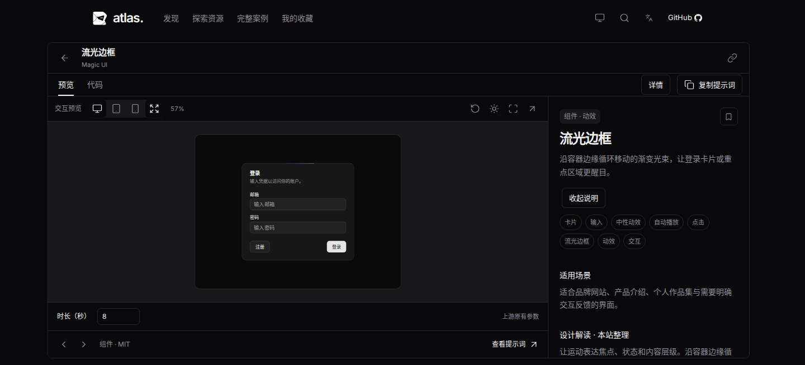
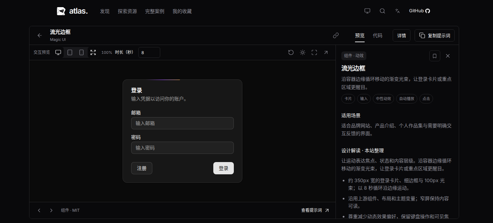
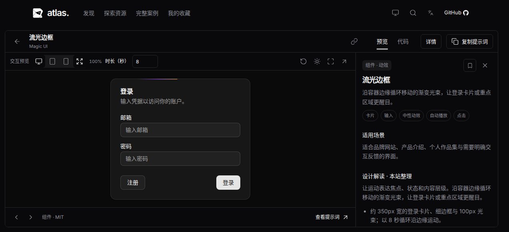
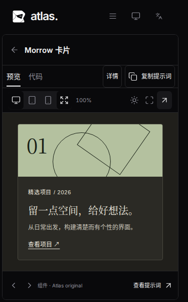

# 组件详情的空间与清晰度

基线为 `b8fc2a3`。用户确认了整屏适配方向，但指出组件小、留白多、展示不清楚。之前缩放整个 640×480 演示画布时，画布内部的 350px 登录卡片和空白一起缩小；标题、预览/代码、工具栏和参数还分别占行。

默认自动模式现在为全部资源使用实际预览容器宽高、scale=1。演示本身响应式排版，组件保留正常字号；手动设备仍等比适应，桌面原尺寸模式仍使用作者视口。UI Market 的详情包装仅减少外围 padding，独立演示、列表内联预览、缩略图和上游组件实现保持原有规则。

1200px 及以上窗口把资源标题和内容操作合为一行；动效参数并入预览工具栏。说明栏保留可访问的标题和全部说明，使用较紧凑的标题与间距、右上角关闭按钮，并过滤重复名称和泛化的附加标签。结构化分类与交互筛选链接继续保留。

## 同一场景实测

下列数据测量实际 Border Beam 登录卡片及其输入框，而非只看 iframe 大小。字号以 iframe 内计算字号乘以外层缩放得到，单位为 CSS px。

| 窗口 | 组件宽度：前 → 后 | 输入字号：前 → 后 | 可用预览高度：前 → 后 |
| --- | --- | --- | --- |
| 1440×655 | 201.25 → 350 | 9.2 → 14 | 324 → 416 |
| 1273×582 | 148.02 → 350 | 6.77 → 14 | 251 → 343 |

[基线尺寸](before-metrics.json)与[当前尺寸](metrics.json)。三个桌面场景中，组件全部位于 iframe 内、外层高度仍等于窗口高度。

较矮窗口也能显示正常大小的卡片：

手机保持整屏布局，长内容在演示内部滚动：

## 验证

`npm run verify` 全部通过：严格检查、11 项单元测试、生产构建、123 项浏览器测试（Chromium 113 项，Firefox/WebKit 各 5 项）及 1 项隔离开发综合测试。启动脚本 gzip 合计 186,909 字节，仍低于 190,000 字节预算；未升级依赖。

新增验收断言检查真实组件宽度、字号、边界、合并工具栏和外层无滚动。切换说明、设备、原尺寸、自动和全屏后，iframe、内部文档和输入不变，新增文档请求为零；参数仍可实际调整。原有手机横屏、页面、案例、源码、主题和下载流程继续通过回归。另行检查英文 1273×582，卡片完整可见。

本地 WebKit 使用临时补齐的运行库，仅跳过系统缓存依赖探测；浏览器流程全部实际执行。CI 正常安装浏览器依赖并运行相同验证入口。
