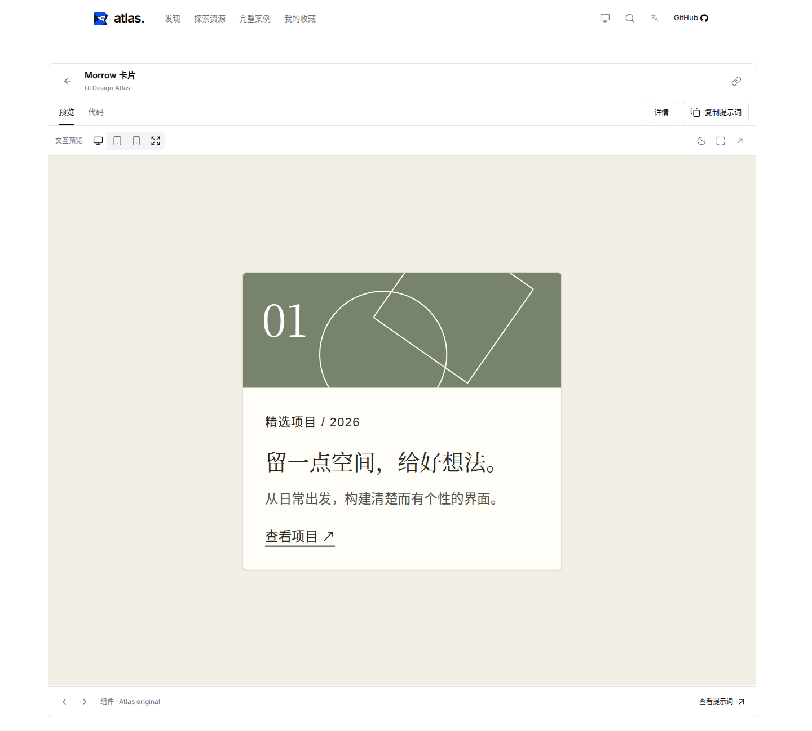
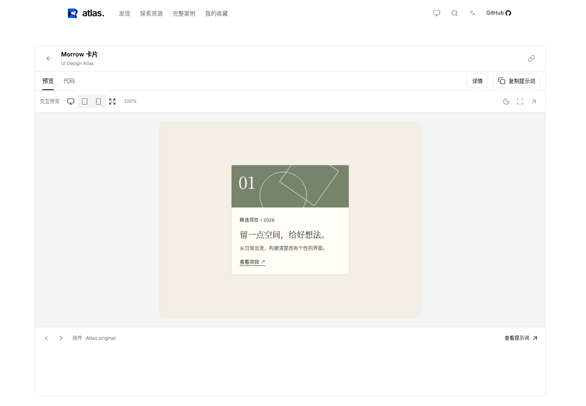
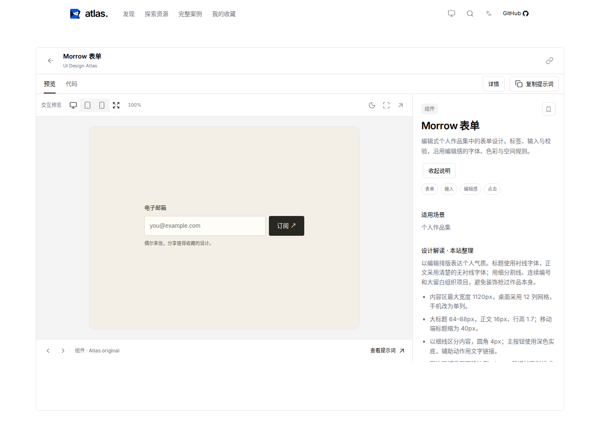
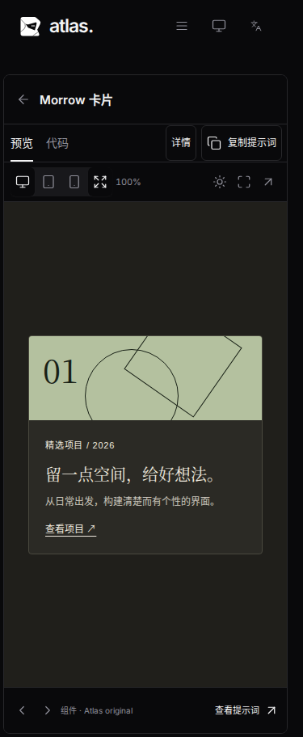

# 组件详情展示修复

在 1440×1000 窗口打开 Morrow 按钮或卡片，原有逻辑把原生 640×480 的演示按整个预览区域放大到 1254×940.5，缩放约为 196%。这同时放大了文字、控件和演示中的留白，把底部操作推到首屏之外。打开说明后，固定黄金分割让说明占约 38% 宽度，组件又随剩余宽度缩放。

现在组件自动预览最多为原始尺寸的 100%，居中显示，外部画布按演示加上下各 24px 留白确定高度。对同一资源，桌面实测是 640×480、画布高 528px。说明栏在桌面使用 300–360px 的宽度；空间充足时开关说明不改变演示尺寸。窄桌面空间不足时等比缩小，手机保持实际容器宽度和 scale=1，长内容可滚动。页面、案例和区块继续使用各自原始画布比例。

工具栏显示实际缩放比例，并明确标识适应画布按钮的选中状态。组件画布以轻边框区分演示本身与查看器留白。

## 视觉对比

修复前，同一张卡片被放大、画布过高：

修复后，卡片按实际大小展示：

打开说明后，表单保持正常尺寸，右栏独立滚动：

## 验证范围

针对性浏览器测试覆盖按钮、卡片、原创表单和 Ant Design 表单的原始尺寸、居中、画布留白及侧栏宽度；开关说明保留 iframe、文档和表单输入，新增文档请求为零。实际操作 Fluent Dialog，检查设备切换、主题和全屏，以及适应画布按钮的选中状态。

375、768、1440、1910px，包含矮窗口、中英文和明暗主题，有截图及尺寸记录；另行检查 1024px 边界和手机动效工具栏，操作按钮未被裁切。详情返回、源码、页面/案例比例及原有流程使用完整测试入口验证。最终命令和结果见本次 PR。

`npm run verify` 已通过：严格检查、11 项单元测试、生产构建、113 项 Playwright（Chromium 107 项，Firefox/WebKit 各 3 项）和 1 项隔离开发综合测试。启动脚本 gzip 合计 187,042 字节，仍低于 190,000 字节预算。本地 WebKit 使用已补齐的临时运行库并只跳过系统缓存依赖探测，所有浏览器流程实际执行。

[响应式尺寸记录](component-detail-metrics.json)。手机中文暗色效果：

尺寸记录以 `viewportWidth` / `viewportHeight` 标记浏览器窗口，`width` / `height` 标记实际渲染的 iframe，避免字段覆盖混淆屏幕尺寸。审核时另在 Chromium、Firefox、WebKit 的 375/1024/1440/1910px 窗口中实际检查说明开关、输入及文档保留和全屏；均通过且没有页面异常。
