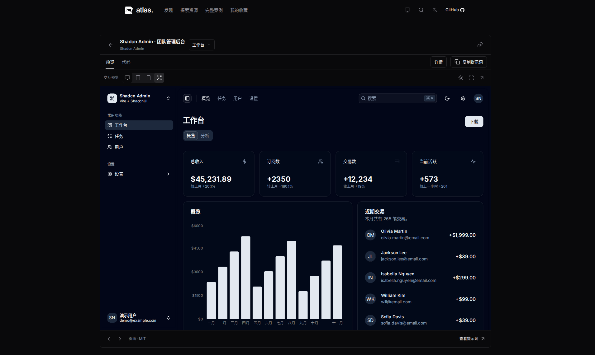

# 详情页比例修正

关联 [Issue #35](https://github.com/Xiiiing/ui-design-atlas/issues/35) 和 [PR #36](https://github.com/Xiiiing/ui-design-atlas/pull/36) 的视觉反馈。

原先桌面详情页强制使用剩余视口高度，但外框铺满屏幕宽度。预览虽然保持原始比例，工具栏占据高度后仍会缩成中间的小块；短窗口或浏览器放大时尤其明显。

现在桌面详情内容居中，外层最大宽度 1280px，预览区按资源原始宽高比例分配高度。窗口较矮时正常向下滚动，不再把预览压成横条。详情栏内容独立滚动，代码面板保持可用高度；平板、手机与全屏继续按可用视口等比适应。切换设备、案例页面时仍保留对应资源尺寸。

在 1910×873 窗口下，实际仪表盘预览从 864×540 变为 1254×783.75，预览区与画布同宽，保持 16:10。1440×655 短窗口保持同样的可读尺寸。

## 验证

- `npm run check`、`npm run build` 通过。
- 构建后 `npm run test:built` 全部 91 项通过，覆盖原始比例、桌面限宽与可读尺寸、设备切换、全屏、说明栏、代码、返回列表及加载重试。
- 实际采集 1910×873、1440×655、768×1024、375×812 在浅色英文和深色中文下的 8 组尺寸，无横向溢出；[测量记录](detail-proportion/measurements.json)。

[短窗口](detail-proportion/1440-dark.png) · [平板](detail-proportion/768-dark.png) · [手机](detail-proportion/375-dark.png)
