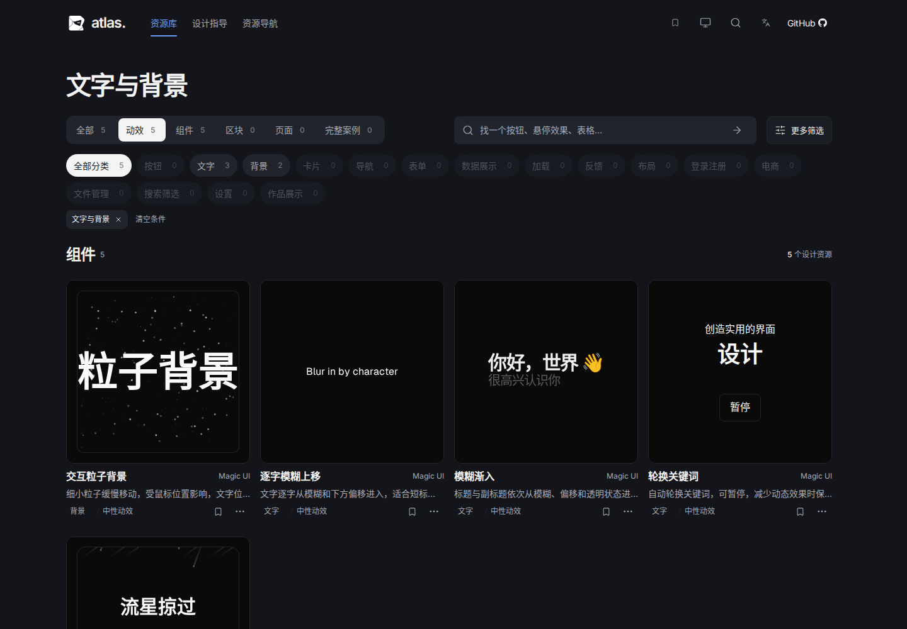

# 编辑式设计图鉴

对应 [Issue #55](https://github.com/Xiiiing/ui-design-atlas/issues/55)。改版基线为 `87383eb`，仅调整图鉴宿主；资源标识、收藏键、组合器草稿、交付包协议及收录演示维持兼容。

## 当前设计与浏览规则

- 保留折角标识和品牌蓝，使用清晰的浅色 / 深色表面。共享变量位于 `shell/theme.css`，复用现有字体和 Radix 控件。
- 页面标题为桌面 40px、手机 30px，区块标题 24px，卡片标题 16–18px，正文 14–16px，辅助文字至少 12px。详情标题按紧凑工具栏和说明栏单独处理。
- 首页直接进入资源库。主导航为资源库、设计指导、资源导航，收藏为独立快捷入口；完整案例在资源库类型导航中。独立发现页及其重复介绍、精选专区已移除。
- `#discover` 旧链接原位转为 `#explore`，保留关键词、合集、所有分面及语言 / 主题参数。默认首页、Logo 链接及未知路由回到资源库；详情返回继续保留筛选、位置和焦点。
- 资源库只保留标题，移除 `ATLAS / LIBRARY` 等装饰副标和重复介绍。类型使用连贯的分段底板，用途分类使用紧凑的圆角胶囊；选中态为高对比实心色，计数保留稳定宽度。分类常显、多选与计数逻辑不变，移动端按钮保持 44px 触控尺寸。
- 组件库、视觉风格、来源及技术等放在“更多筛选”。原来的主题合集也在此提供入口，原有合集链接仍有效。筛选收起后，已选条件继续可见并能单独移除。
- 普通资源网格宽屏四列、16px 列间距；1199px 及以下三列、899px 及以下两列、599px 及以下一列。名称和来源同行，简介一行、最多两个标签，收藏常显，复制和详情收入键盘 / 触屏可操作的更多菜单。预览和动效保留原有设计。
- 详情依次组织简介、设计解读、提示词、来源与关联内容。提示词和来源可折叠，复制无需展开。说明层独立滚动，开关与折叠不改变预览尺寸或位置。
- 设计指导与资源导航和资源库一样只保留简短标题。类型用常显分段按钮，指导用途用圆角分类按钮，搜索内置提交入口。两页类型按钮复用资源库的弹性选中指示块，连续切换可接续动效，键盘焦点与按钮尺寸稳定，减少动效模式立即定位；计数、零结果禁用、URL 与历史恢复继续可用。
- 指导、导航与混合收藏的内容卡片宽屏四列、16px 间距与内边距、8px 内容间距，简介最多两行；阅读页的相关卡片保留两列。阅读正文限制宽度。组合器分为项目需求、方法与参考、交付要求，宽屏双栏，900px 及以下纵向排列。

来源页和使用指南按需加载；最终生产构建启动脚本 gzip 为 **187,848 字节**，低于 190,000 字节上限。预算未放宽。

## 前后对比

当前桌面截图为中文、浅色、1440 × 1000，手机截图为英文、深色、390 × 1000。首页改为资源库，因此首页对比体现入口结构的变化；其他页面保持对应路由及详情说明状态。动态演示的动画帧不作为宿主设计差异。

| 页面 | 初始改版前 | 当前版本 | 移动端深色 |
| --- | --- | --- | --- |
| 首页入口 | [前](before-home.png) | [当前资源库首页](after-home.png) | [手机](after-home-mobile-dark.png) |
| 资源库 | [前](before-library.png) | [后](after-library.png) | [手机](after-library-mobile-dark.png) |
| 详情 | [前](before-detail.png) | [后](after-detail.png) | [手机](after-detail-mobile-dark.png) |
| 设计指导 | [前](before-guidance.png) | [后](after-guidance.png) | [手机](after-guidance-mobile-dark.png) |
| 组合器 | [前](before-composer.png) | [后](after-composer.png) | [手机](after-composer-mobile-dark.png) |
| 资源导航 | [本轮调整前](before-compact-tools.png) | [后](after-directory.png) | [手机](after-directory-mobile-dark.png) |

本次以 `2780f8c` 为调整前基线：[原发现页](before-library-home.png) / [当前首页](after-home.png)。针对反馈截图，使用相同的“文字与背景”合集、动效类型、深色主题和 1440 × 1000 窗口比较：[按钮调整前](before-filter-controls.png) / [调整后](after-filter-controls.png)。

本轮补齐设计指导与资源导航，基线为 `bad3b55`：[指导调整前](before-compact-guidance.png) / [调整后](after-guidance.png)，[导航调整前](before-compact-tools.png) / [调整后](after-directory.png)。

类型按钮动效录屏：[设计指导](guidance-type-motion.webm) / [资源导航](tools-type-motion.webm)。两页使用同一套宿主组件，没有改动收录演示。



历史过程截图保留供比较：[卡片密度调整前](before-density-home.png)、[调整后](after-density-home.png)、[调整后深色](after-density-home-dark.png)、[分类常显前的首页](before-category-home.png)、[分类常显前的资源库](before-category-library.png)。它们是对应阶段的记录，当前设计以本页规则和 `after-home.png` / `after-library.png` 为准。

## 验收范围与证据

`npm run check` 通过目录校验、主站及两个示例的类型检查和 21 项单元测试。当前完整 `npm test` 完成生产构建及 189 项浏览器测试（Chromium 171、Firefox 9、WebKit 9），全部通过；`npm run test:dev` 的隔离开发环境更新流程也通过。

类型切换增加了实际动画帧检查：指示块经过起点与终点之间的位置、连续切换保留同一指示块、按钮文字及尺寸不位移。另验证手机触屏与横向滚动、中英文、减少动效模式，以及重载后零结果类型仍禁用。

另外实测两页在 390px 深色、减少动效下的触屏筛选、收藏、详情与返回恢复，均通过。

| 验收内容 | 对应流程 |
| --- | --- |
| 默认资源库首页、发现页链接兼容、分类键盘 / 触屏操作、紧凑标题 | `tests/editorial-atlas.spec.mjs` |
| 合集入口、完整案例、搜索排序、详情返回及分页恢复 | `tests/discovery.spec.mjs` |
| 多条件筛选、计数、逐项移除、原生链接和历史恢复 | `tests/facets.spec.mjs`、`tests/inline-experience.spec.mjs`、`tests/liquid-selection.spec.mjs` |
| 卡片内交互、键盘与触屏菜单、复制、收藏 | `tests/card-preview.spec.mjs`、`tests/editorial-atlas.spec.mjs`、`tests/atlas.spec.mjs` |
| 设备模拟、说明独立滚动、全屏及 API 降级 | `tests/wide-experience.spec.mjs`、`tests/viewport-fit.spec.mjs`、`tests/immersive-preview.spec.mjs`、`tests/cross-browser.spec.mjs` |
| 指导阅读、混合收藏、组合器草稿恢复、手动编辑、复制与 Markdown 导出 | `tests/guidance.spec.mjs`、`tests/composer.spec.mjs`、`tests/cross-browser.spec.mjs` |
| 中英文、明暗主题、减少动效、浏览器原生缩放 | `tests/navigation-theme.spec.mjs`、`tests/native-zoom.spec.mjs`、下述截图脚本 |

[acceptance.json](acceptance.json) 记录当前生产构建的宿主文件 SHA-256、文件清单、逐入口尺寸与字号，以及原生缩放实测值。截图脚本检查默认首页、显式资源库路由、详情、指导、组合器、资源导航和空收藏页：

- 1440 / 1024 / 768 / 390px × 中英文 × 明暗主题 × 七个入口，共 112 组；英文场景开启减少动效偏好。所有入口无横向溢出，未捕获页面脚本异常。
- 110% / 125% 原生浏览器缩放 × 前六个入口，共 12 组；验证实际 `devicePixelRatio` 和页面边界，并检查详情开关前后的预览几何一致。完整测试还覆盖真实滚动条和多种预览类型。
- 实际查看桌面及手机截图，核对入口、层级、正文和预览。截图与构建标识对应，未将构建成功替代交互验收。

WebKit 验收使用发行版软件包解压出的临时运行库，通过 `LD_LIBRARY_PATH` / `GST_PLUGIN_PATH` 加载，没有更改项目依赖或系统配置。Playwright 对动态库的预检只查询系统 `ldconfig` 缓存，不能识别临时库，因此该次运行关闭环境预检；WebKit 实际执行全部核心流程，未跳过测试断言。常规环境按项目说明安装 Playwright 的系统依赖即可直接运行 `npm test`。

## 重现

```sh
npm run check
npm test
```

构建完成后，在独立终端启动截图服务，再运行截图脚本（需要 Playwright Chromium 及原生缩放测试所需的 Xvfb）：

```sh
PORT=4174 node scripts/serve.mjs --dist --base=/ui-design-atlas/
```

```sh
node scripts/capture-editorial-atlas.mjs
```

脚本默认访问 4174，可通过 `ATLAS_CAPTURE_URL` 指定当前构建的服务地址。它更新当前版本截图及验收 JSON，不覆盖历史基线图片。不要在构建中途运行，确保服务指向当前 `dist`。
