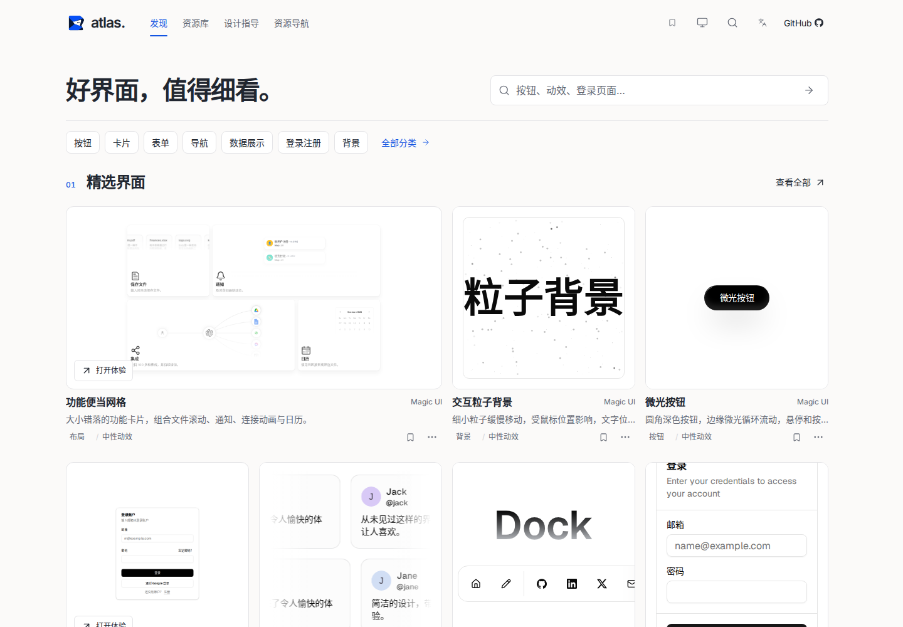

# 编辑式设计图鉴

对应 [Issue #55](https://github.com/Xiiiing/ui-design-atlas/issues/55)。改版基线为 `87383eb`，仅调整图鉴宿主；资源标识、收藏键、组合器草稿、交付包协议及收录演示维持兼容。

## 设计与浏览规则

- 保留折角标识，以近白 / 深灰表面和蓝色操作色组织层次。共享变量位于 `shell/theme.css`，主站样式按基础、浏览、导航、预览、指导划分，复用现有字体和 Radix 控件。
- 页面标题为桌面 40px、手机 30px，区块标题 24px，卡片标题 16–18px，正文 14–16px，辅助文字至少 12px。详情标题按紧凑工具栏和说明栏单独处理。布局以 8px 间距组织，控件和卡片统一圆角，阴影用于浮层。
- 主导航保留发现、资源库、设计指导、资源导航，收藏为独立快捷入口。完整案例属于资源库类型导航；旧路由仍有效，资源库导航记住最近类型。
- 发现页依次展示标题和搜索、八个精选界面、主题合集、完整案例、设计指导入口。首屏移除重复介绍、副标和额外导流链接，保留各区块的查看全部。只有首个精选卡片跨列，普通列表使用等宽网格。首页搜索和旧发现页筛选链接转入资源库并保留条件。
- 宽屏资源网格使用四列、16px 列间距；1199px 及以下三列、899px 及以下两列、599px 及以下一列。完整案例专区使用三列并随窄屏收拢。名称和来源同行，简介一行，移除卡片底部分隔线和多余留白，移动端菜单和收藏仍保留 44px 触控尺寸。
- 用途分类常显于资源库，保留计数、多选和逐项移除；首页增加按钮、卡片、表单、导航、数据展示、登录注册、背景及全部分类的直达入口。其他分面放在“更多筛选”中，收起不影响分类操作。分类沿用现有标识及 URL 参数，不迁移收藏或目录数据。
- 卡片展示标题、来源、简介和最多两个标签，收藏常显，复制和详情收入可键盘 / 触屏操作的更多菜单。完整简介可在详情阅读，桌面悬停简介也可查看全文。菜单关闭及详情返回恢复触发器焦点。
- 详情依次组织简介、设计解读、提示词、来源与关联内容。提示词全文和来源可折叠，复制无需展开。说明层独立滚动，开关与折叠不改变预览尺寸或位置。
- 指导、导航、收藏共用标题、卡片和空状态规则，阅读正文限制宽度。组合器分为项目需求、方法与参考、交付要求，宽屏双栏，900px 及以下纵向排列。

为了保持启动脚本预算，来源页和使用指南按需加载；最终生产构建启动脚本 gzip 为 **188,969 字节**，低于 190,000 字节上限。预算未放宽。

## 前后对比

桌面截图均为中文、浅色、1440 × 1000，捕获同一路由及详情说明状态。另保存英文、深色、390 × 1000 的移动端截图。截图展示首屏；完整页面由下述浏览器流程和尺寸矩阵验证。动态演示的动画帧不作为宿主设计差异。

| 页面 | 改版前 | 改版后 | 移动端深色 |
| --- | --- | --- | --- |
| 发现 | [前](before-home.png) | [后](after-home.png) | [手机](after-home-mobile-dark.png) |
| 资源库 | [前](before-library.png) | [后](after-library.png) | [手机](after-library-mobile-dark.png) |
| 详情 | [前](before-detail.png) | [后](after-detail.png) | [手机](after-detail-mobile-dark.png) |
| 设计指导 | [前](before-guidance.png) | [后](after-guidance.png) | [手机](after-guidance-mobile-dark.png) |
| 组合器 | [前](before-composer.png) | [后](after-composer.png) | [手机](after-composer-mobile-dark.png) |



### 首屏与卡片密度调整

`0e4efd5` 的密度调整以 `d032cb5` 为基线，在 1440 × 1000 的窗口实测：介绍区由约 292px 缩至 89px，卡片说明区由 172px 缩至 92px，预览高度由约 389px 缩至 292px。首行展示三个精选资源，后续普通行展示四个；该阶段首张卡片由距顶部约 504px 提前至 277px。后续增加常用分类快捷入口后为 329px，介绍区及卡片尺寸保持不变。移动端说明区为 104px，保持完整触控尺寸。

[密度调整前](before-density-home.png) · [调整后](after-density-home.png) · [调整后深色](after-density-home-dark.png)。前后浅色截图使用相同窗口与路由；调整前图片保留自上一阶段的验收截图。

## 验收范围与证据

分类入口调整对比：[首页调整前](before-category-home.png) / [当前首页](after-home.png)，[资源库调整前](before-category-library.png) / [当前资源库](after-library.png)。前图来自 `0e4efd5` 的验收截图。首页直达分类、分类多选、重载恢复、清除条件以及手机触屏入口由 `tests/editorial-atlas.spec.mjs` 实际验证；分类按钮常显，更多筛选默认收起。

`npm run check` 通过目录校验、主站及两个示例的类型检查和 21 项单元测试。`npm test` 完成生产构建及全量回归；分类入口增加后，首屏验收改为检查首个预览完整可见，触屏表单测试先滚动到卡片再等待其按需加载。对同一构建复验 `editorial-atlas` 与 `inline-experience` 后，最终 184 项浏览器用例均通过：Chromium 166 项、Firefox 9 项、WebKit 9 项。

| 验收内容 | 对应流程 |
| --- | --- |
| 首页搜索、旧链接、等宽网格、固定导航、内容工具字号 | `tests/editorial-atlas.spec.mjs` |
| 多条件筛选、计数、逐项移除、原生链接和历史恢复 | `tests/facets.spec.mjs`、`tests/inline-experience.spec.mjs`、`tests/liquid-selection.spec.mjs` |
| 卡片内交互、键盘与触屏菜单、复制、收藏 | `tests/card-preview.spec.mjs`、`tests/editorial-atlas.spec.mjs`、`tests/atlas.spec.mjs` |
| 详情返回、设备模拟、说明独立滚动、全屏及 API 降级 | `tests/wide-experience.spec.mjs`、`tests/viewport-fit.spec.mjs`、`tests/immersive-preview.spec.mjs`、`tests/cross-browser.spec.mjs` |
| 指导阅读、混合收藏、组合器草稿恢复、手动编辑、复制与 Markdown 导出 | `tests/guidance.spec.mjs`、`tests/composer.spec.mjs`、`tests/cross-browser.spec.mjs` |
| 中英文、明暗主题、减少动效、浏览器原生缩放 | `tests/navigation-theme.spec.mjs`、`tests/native-zoom.spec.mjs`、下述截图脚本 |

[acceptance.json](acceptance.json) 记录当前生产构建的宿主文件 SHA-256、文件清单、逐页面尺寸与字号，以及原生缩放实测值。截图脚本检查发现、资源库、详情、指导、组合器、资源导航和空收藏页：

- 1440 / 1024 / 768 / 390px × 中英文 × 明暗主题 × 七个页面，共 112 组；英文场景开启减少动效偏好。所有页面无横向溢出，未捕获页面脚本异常。
- 110% / 125% 原生浏览器缩放 × 前五个页面，共 10 组；验证实际 `devicePixelRatio` 和页面边界，并检查详情开关前后的预览几何一致。完整测试还覆盖真实滚动条和多种预览类型。
- 实际查看桌面及手机截图，核对入口、层级、正文和预览。截图与构建标识对应，未将模拟数据或构建成功替代交互验收。

WebKit 的运行环境最初缺少系统库。验收使用发行版软件包解压出的临时运行库，通过 `LD_LIBRARY_PATH` / `GST_PLUGIN_PATH` 加载，没有更改项目依赖或系统配置。Playwright 对动态库的预检只查询系统 `ldconfig` 缓存，不能识别临时库，因此该次运行关闭了这项环境预检；WebKit 浏览器实际启动并执行全部九项测试，未跳过测试断言。常规环境按项目说明安装 Playwright 的系统依赖即可直接运行 `npm test`。

## 重现

```sh
npm run check
npm test
```

构建完成后，在独立终端启动截图服务，再运行截图脚本（需要 Playwright Chromium 及原生缩放测试所需的 Xvfb）：

```sh
PORT=4174 node scripts/serve.mjs --dist --base=/ui-design-atlas/
```

```sh
node scripts/capture-editorial-atlas.mjs
```

脚本默认访问 4174，可通过 `ATLAS_CAPTURE_URL` 指定当前构建的服务地址。它更新改版后截图及验收 JSON，不覆盖改版前基线图片。不要在构建中途运行，确保服务指向当前 `dist`。
