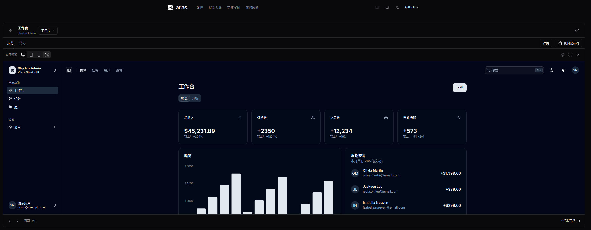
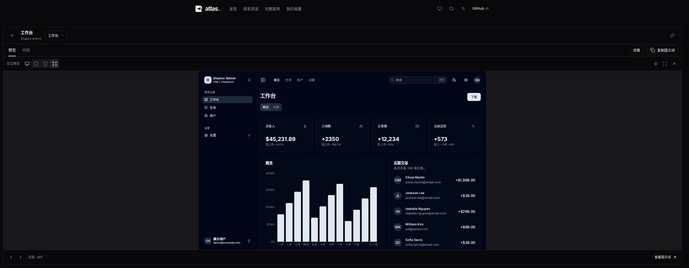

# 体验页保留原始比例

关联 [Issue #23](https://github.com/Xiiiing/ui-design-atlas/issues/23)。

此前体验页将 iframe 宽度撑满剩余空间，高度独立取剩余视口。2560×1000 下，原本 1280×800 的仪表盘变为 2519×667，比例从 1.6 变为约 3.78。旧测试只保证没有多余滚动，没有验证资源比例。

现在默认使用资源的 `preview.width / preview.height`，宽高一起缩放，比例取可用宽度和高度约束中的较小值，画布居中。相同窗口下仪表盘变为约 1067×667，保持 16:10，且已用满可用高度。区块的 1280×900、小组件的 640×480 等尺寸分别保留，不统一强制成 16:9。

宽资源在小于 1024px 的窗口中自动采用平板 768×1024 或手机 375×812 画布，保持响应式布局。自动设备依据窗口宽度选择，打开说明侧栏不会误切换设备。用户也能手动选择设备；窗口、侧栏和全屏变化后重新等比适应。

“等比适应画布”默认开启，外层无额外内容滚动；关闭后显示原始像素大小，允许明确的外层平移，画布左侧和顶部仍可访问。再次开启恢复完整适应。长页面、表格、侧栏继续在演示内部滚动。

## 验证

- `npm run check`（含 5 项单元测试）、`npm run build` 通过。构建保留既有的示例 chunk 体积提示。
- 完整 `npm test`：74 项通过。专项测试覆盖 2560×1080、1440×900、1440×600、768×1024、375×812 的比例、最大尺寸、居中、无溢出、原始大小切换、详情栏及设备切换；还实际打开/关闭 Fluent 弹窗、滚动长内容到底，并检查全屏和退出后的比例。
- [测量记录](experience-aspect/verification.json) 含构建文件 SHA-256、原生尺寸、显示尺寸、画布坐标和溢出值；采集未出现页面脚本异常。
- [真实操作录屏](experience-aspect/interaction.webm)：列表进入区块、全屏、手机设备、详情栏、弹窗打开与关闭。

[1440px 浅色英文](experience-aspect/after-1440.png) · [矮窗口](experience-aspect/after-1440-short.png) · [平板](experience-aspect/after-768.png) · [手机](experience-aspect/after-375.png) · [原始区块比例](experience-aspect/block-original-ratio.png) · [全屏](experience-aspect/fullscreen.png) · [弹窗](experience-aspect/dialog.png)

复现采集：构建后启动 `node scripts/serve.mjs --dist --base=/ui-design-atlas/`，运行 `node scripts/capture-experience-aspect.mjs`。`before-2560.png` 在修改前构建采集，脚本只更新修复后的证据。
