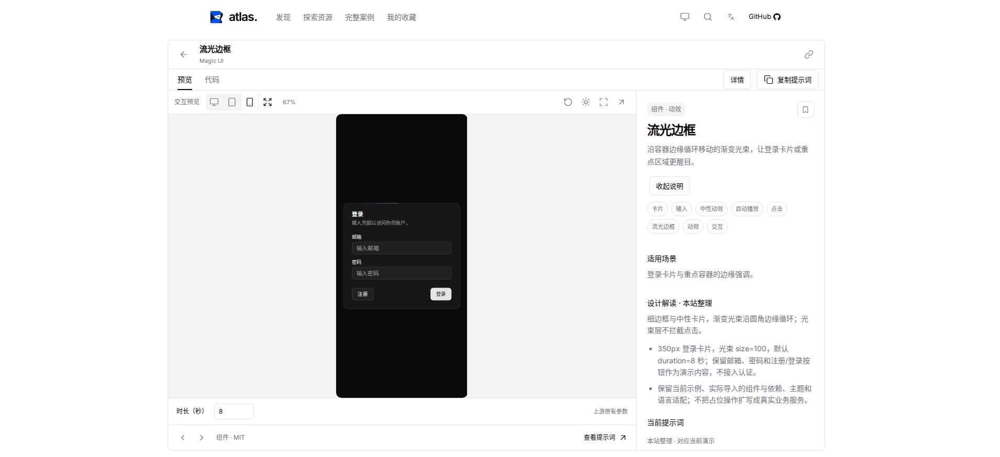
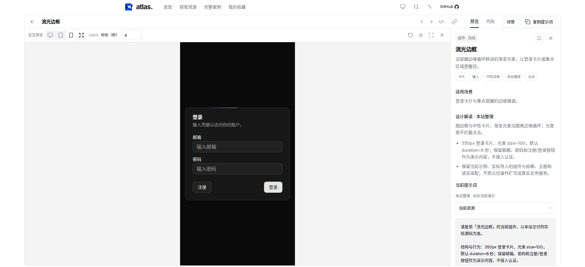
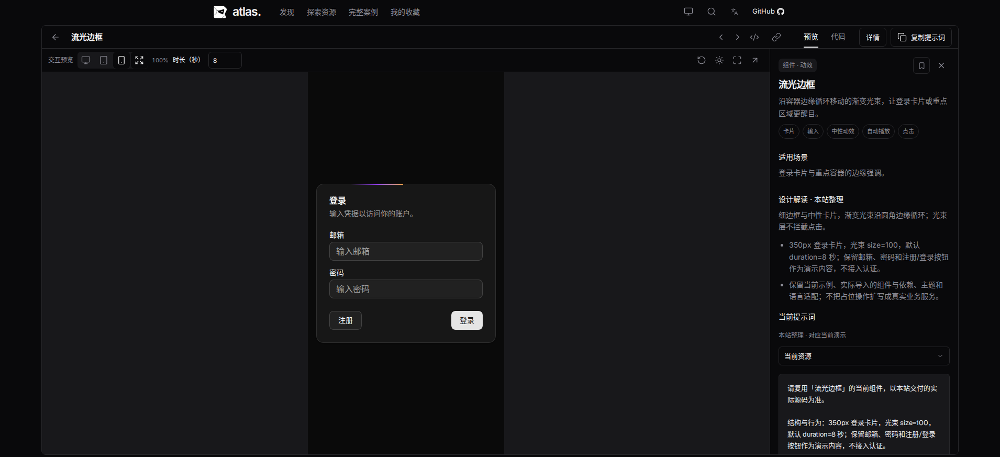
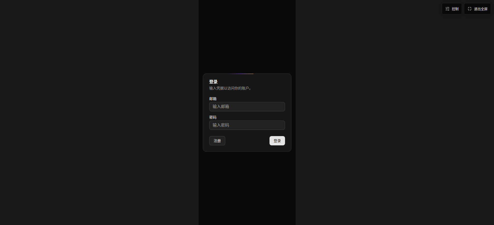
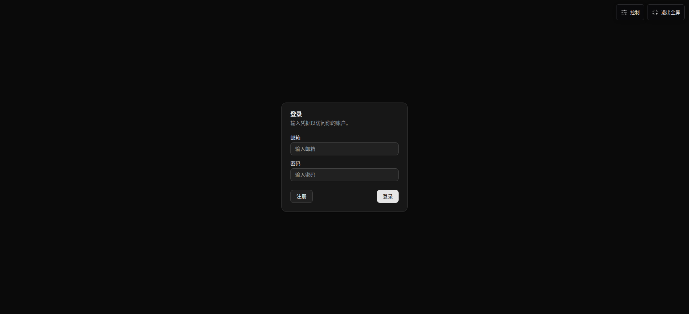
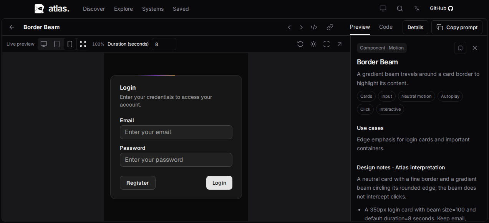
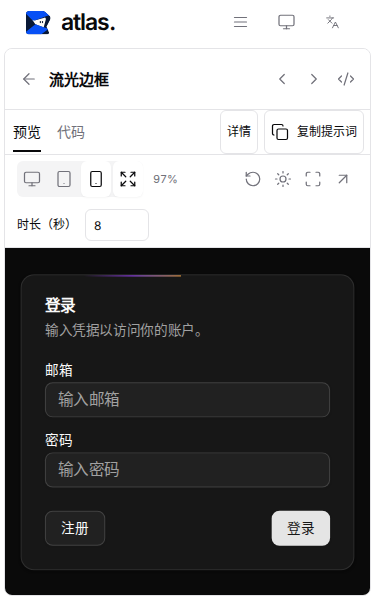

# 详情空间与全屏体验

本轮延续 Issue #43 / PR #44。基线为已合入文案修复的 `main`（`f891261`）中的查看器；PR #44 的首版布局当时仍未合入，因此线上截图仍有多排工具栏和按高度缩小的设备预览。本轮在同一 PR 上整合最新 main，保留提交历史。

## 当前行为

- 普通桌面保留 44px 主导航，把标题、内容切换、资源切换和提示词入口放在同一行；参数位于预览工具栏。移除单独的底部操作行，宽屏内容居中限宽 1760px。手机允许控件换行，返回、设备及参数保持可达。
- 自动模式使用当前容器宽高与原生像素。375/768 按钮固定模拟宽度，只有宽度不足才等比缩小；文档高度使用可见高度反算，长内容在 iframe 内滚动。不会再因固定的 812/1024px 高度把输入控件缩成很小的字。原尺寸模式继续支持作者视口。
- 全屏中预览占满实际浏览器视口，工具栏按需浮出，不预留顶部或底部行。右上角常驻“控制”和“退出全屏”；保持所选设备宽度，切换“自动”即可使用整屏宽度。
- 优先使用浏览器全屏 API，失败或不支持时使用同样布局的页内全屏。退出按钮、Escape、进入期间取消、焦点恢复及背景焦点约束均覆盖；演示主动加载新文档后，页内全屏的 Escape 仍可使用。
- 开关说明、设备、全屏和参数不重建 iframe；当前输入和参数保持。浏览器原生退出后同步按钮状态。

## 同场景测量

1910×873、Border Beam、详情打开、375px 模拟宽度；前后主站均为浅色，演示均为深色。测量实际 iframe 宽度及输入框计算字号乘以外层缩放，未用构建通过代替体验验证。

| 指标 | 基线 | 当前 |
| --- | --- | --- |
| 预览可视高度 | 542px | 730px |
| 可视高度占窗口比例 | 62.1% | 83.6% |
| 手机预览显示宽度 | 250.31px | 375px |
| 输入实际字号 | 10.68px | 16px |
| 自动全屏预览 | 仍有工具栏、底栏 | 1910×873px，从 (0,0) 开始 |

[基线测量](before.json)、[当前测量与其他尺寸](metrics.json)。1273×582 英文深色下预览高 439px、手机显示宽 375px、输入字号 16px；375×600 下宽度不足按宽度缩至 365px，输入约 15.57px。均无外层文档溢出。

全屏保留手机模拟：

全屏切换自动宽度：

## 验证范围

新增检查直接测量 iframe、实际输入字号和可视区域；测试原生全屏与 API 拒绝回退、浮动工具栏、参数、设备切换、输入/文档保留与零额外文档请求。通过可控的延迟请求验证快速 Escape 取消，防止进入期间把资源页一起关闭。演示主动重载后也验证回退模式可从 iframe 中 Escape 退出。

Chromium、Firefox、WebKit 均执行设备/全屏/退出/焦点流程。原生全屏的断言使用浏览器当前 innerWidth/innerHeight，适应 Firefox 从模拟窗口转为实际屏幕尺寸的行为。

## 最终检查

实现提交 `44ab55f`；后续文档提交不改变已验证源码。`npm run check`、`npm run build`、`npm run test:built` 和 `npm run test:dev` 全部通过，对应 verify 的完整验证链路；测试使用本次构建，Playwright 禁止复用未知服务器。

- 12 项单元测试和全部严格检查通过。
- 135 项浏览器测试通过：Chromium 123、Firefox 6、WebKit 6；0 跳过、0 flaky。
- 全屏与快速取消相关检查另连续执行三轮，共 18 项通过。
- 1 项隔离开发服务综合测试通过。
- 主文档启动脚本 gzip 合计 187,601 字节，低于 190,000 字节预算。未升级依赖。
- 本地 WebKit 使用预先补齐的运行库，仅跳过系统依赖探测；浏览器流程实际执行。

截图与测量使用当前源码；真实触屏设备及操作系统级全屏手势未另行人工验证，触屏流程由浏览器自动化覆盖。普通查看、说明、源码、设备、主题、收藏、历史和下载回归仍通过。
