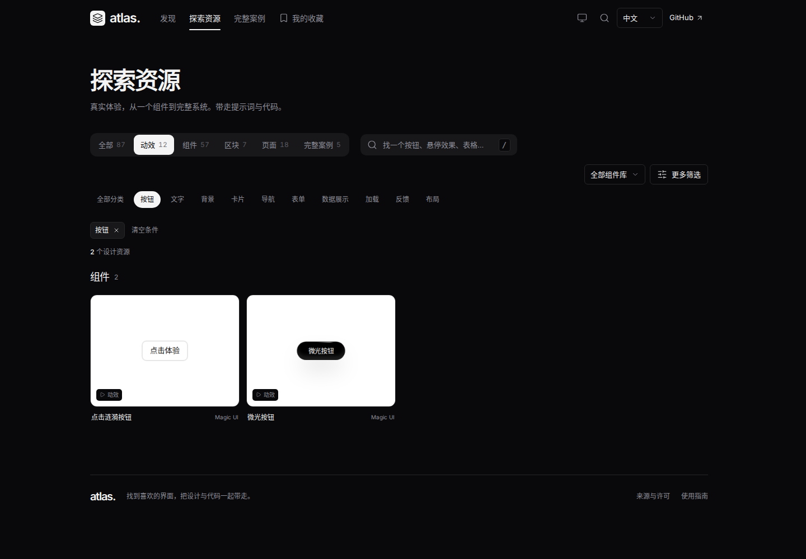

# 分类点击与液态选中修复

关联 [Issue #5](https://github.com/Xiiiing/ui-design-atlas/issues/5)。基线为 `7d81e2f07be78edab5988c23d4837d05e36d650c`。

## 复现与原因

打开 `#motion?lang=zh-CN`，点击“按钮”。原实现将空的已选条件区域设为 `display:none`，首次出现标签时增加了 44px，结果数量、分组标题和资源卡片随之下移。在 1850×1100 的浏览器中，结果数量行的顶部从 384.296875px 移至 428.296875px。

另外，shell 的 selection 适配器只生成普通 HTML，未实例化已经归档的 `SelectionGroup`，类型与分类仅切换静态背景。首页和列表的类型计数不一致，也会改变按钮宽度。

## 修改

- 直接复用不可变归档中的 [SelectionGroup](../../vendor/yingxu-ui/reference/react/SelectionGroup.tsx)，保留出处与原文件校验。只采用其运动实现，沿用图鉴当前的 21st 中性色变量。
- 类型和用途分类共用稳定的 React 挂载键；首页进入分类列表、连续切换类型和快速改选时保留同一个标记。弹簧参数为 stiffness 440、damping 34、mass 0.75。标记随实际水平速度轻微拉伸，文字与点击区域不缩放。
- 统一首页与列表的六类计数、字级、数字宽度和按钮尺寸。列表标题固定为浏览上下文，分类由高亮和已选标签表达，避免点击与刷新产生不同标题。
- 为首行筛选标签保留 44px。更多条件可自然换行；关闭高级筛选仍保留条件。
- 路由渲染期间保留导航焦点。标记不拦截点击并设为 `aria-hidden`；沿用原组件的滚动、尺寸和字体测量，以及减少动态效果适配。

## 验证

`npm run check`、`npm run build` 和 `npm test`（40 项）通过。构建仍有已有演示的 chunk 体积提示。

新增浏览器回归覆盖：逐帧检查快速改选时单一标记连续运动、速度拉伸、按钮几何不变与结果位置不变；跨首页、类型和分类保留标记；键盘焦点与 Space/Enter；前进后退与刷新；中英文、1440/768/375px、横向滚动、尺寸变化及减少动态效果。减少动态效果测试允许异步渲染停留在旧位置的一帧，但要求没有中间运动位置或拉伸，并最终对齐。

[截图与逐项坐标记录](./liquid-selection/verification.json) 来自实际构建；记录包含 `atlas-shell.js` 的 SHA-256。矩阵截图采集时拦截了全部外部来源请求，未出现页面错误或横向溢出。所有 12 个组合中，选择和清除“按钮”前后的结果数量行顶部相同。

- [桌面中文深色](./liquid-selection/buttons-1440-dark-zh-CN.png)
- [平板英文浅色](./liquid-selection/buttons-768-light-en.png)
- [手机中文深色](./liquid-selection/buttons-375-dark-zh-CN.png)
- [交互录屏](./liquid-selection/interaction.webm)：首页进入动效 → 连续快速改选 → 按钮预览 → 组件类型 → 浏览器返回。

复现截图和录屏：构建后启动 `node scripts/serve.mjs --dist --base=/ui-design-atlas/`，再运行 `node scripts/capture-liquid-selection.mjs`。

此次只交付修复 PR，未合并或发布。
