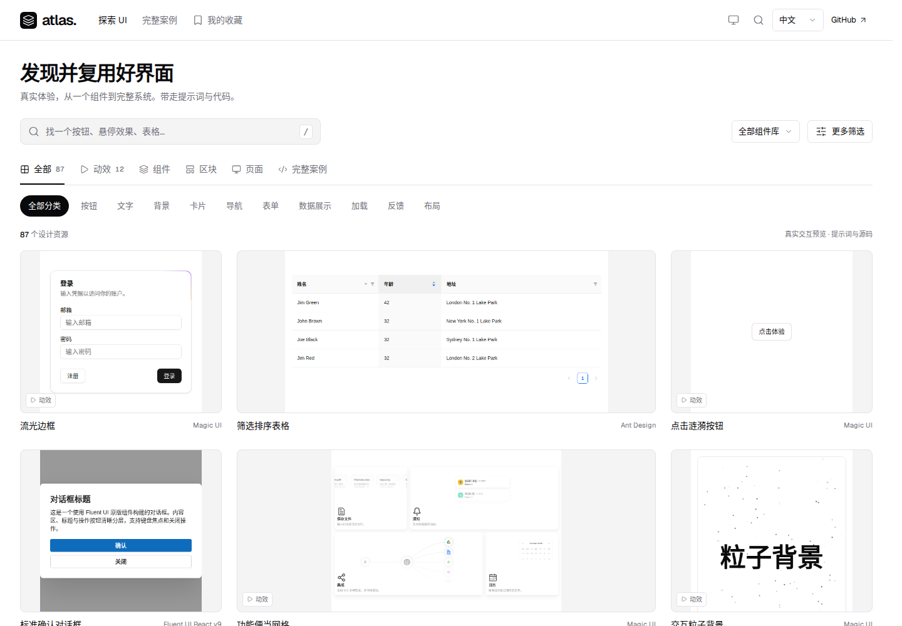
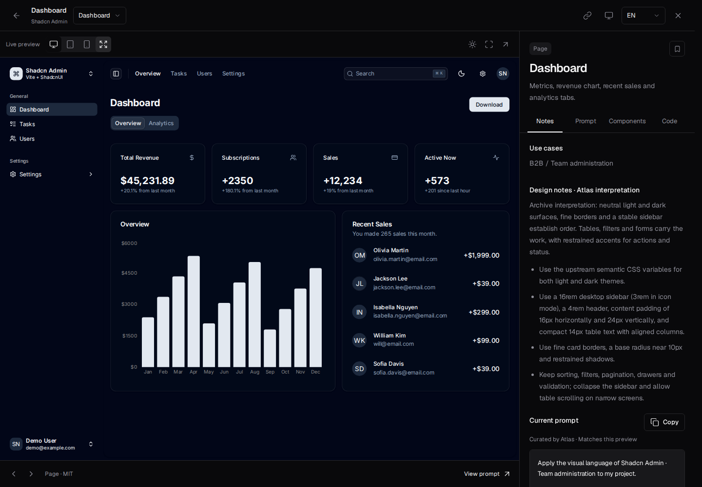
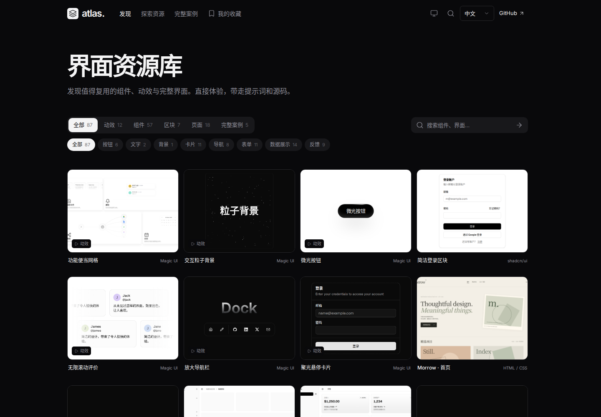

# 图鉴资源市场：设计依据与验收

## 设计来源

外层主要参考 [21st 资源市场](https://21st.dev/community/components)，源码固定为
[`b96d84dcf748d5e56f2f72f2bab9a4f7f33574cf`](https://github.com/serafimcloud/21st/tree/b96d84dcf748d5e56f2f72f2bab9a4f7f33574cf)。
[原始参考与 MIT 许可](../../vendor/21st-market/ATTRIBUTION.md)随项目保留并校验 SHA-256。
公开源码版本早于目前官网；本次是基于固定源码的业务适配，不声称与当前官网像素一致。

| 参考部分                                                                        | 图鉴中的应用                                                                   |
| ------------------------------------------------------------------------------- | ------------------------------------------------------------------------------ |
| 21st globals.css 的 background、foreground、muted、border、input、ring、primary | 同一套中性明暗表面、文字、边框、焦点与操作色，无额外品牌调色板                 |
| Tailwind 配置中的 Geist、默认字级与间距、8px 圆角                               | 本地 Geist 5.3.0（OFL）、中文系统字体回退，12/14/16/24/32px 字级、4px 间距步进 |
| 21st 卡片和横向分类示例                                                         | 预览优先，卡片下方只放名称和组件库，分类与已选筛选条件明确分开                 |
| [Origin UI 按钮页](https://coss.com/origin/button)                              | 小组件采用紧凑的真实取景，避免按钮被缩进整张页面截图                           |
| [Blocks.so 表格页](https://blocks.so/tables)                                    | 表格、区块和完整页面使用宽预览，并提供设备宽度与原尺寸操作                     |
| [React Bits 动效页](https://reactbits.dev/text-animations/split-text)           | 重播和原有参数紧邻舞台；不收录或再分发该站组件                                 |

映序的历史设计资料及许可证保留，但运行中的图鉴不再导入其样式或专用控件。
收录演示仍隔离在同源 iframe 中，保留自身组件库与主题。

## 展示与复用规则

- 文档滚动，轻量吸顶导航；1440px 最大内容宽度，首屏直接提供搜索、分类和资源。
- 1440px 为四列基础网格，宽资源跨两列；768px 两列，375px 一列。保持 DOM 与阅读顺序，不进行瀑布流重排。
- `presentation.js` 统一封面、悬停与详情的规格。普通组件封面为 400×400；区块、页面、案例及原画布宽度至少 900px 的组件使用宽规格。
- 桌面说明栏固定 360px，1024px 以下上下排列。手机紧凑预览保留足够高度，让完整登录卡片及操作按钮可见。
- 所有筛选条件都有可单独清除的标签。折叠更多筛选只隐藏表单，不改变值；URL、刷新、弹层返回保留浏览上下文。
- 原有 ID、87 项统一资源、hash 链接、收藏格式、双语、主题、源码和项目下载保持兼容。首批 24 项，最多两个悬停演示，离屏卸载。

## 嵌入适配

`embed=1` 隐藏 UI Market 独立演示的适配工具条，避免与图鉴操作重复。独立打开不携带此参数，继续提供原有工具条。
仅将原本已有的时长、粒子数量和目标数值放到舞台旁边。父页面发送同源
`atlas:preview-settings` 消息，`settings` 仅包含 `duration`、`quantity` 或 `value`；演示校验来源与数值范围后更新现有组件 props。
调参后的提示词追加明确的当前参数覆盖，复制内容与实际预览一致；重播保留参数。

页面默认按照注册表中的原始桌面宽度渲染，再缩放至预览容器；旁栏不会触发演示移动断点。
设备切换、原尺寸、全屏、内部页面导航、嵌套对话框、焦点和关闭返回均沿用同一流程。

## 验证与复现

```sh
npm run check
npm run build
npm test
# 构建产物须先以 Pages 子路径启动
node scripts/serve.mjs --dist --base=/ui-design-atlas/
# 另一个终端生成真实截图和录屏
node scripts/capture-market.mjs
```

本次本地验证：

- 内容、来源校验、两套演示 TypeScript 检查及完整静态构建通过。
- 27 项 Playwright 测试通过；包括原有后台操作、收藏备份、旧链接、组合筛选与清除、滚动及焦点恢复、动效真实参数与重播、360px 说明栏、桌面画布和全屏。
- 1440／768／375px × 中英文 × 明暗共 12 组浏览器检查；36 张首页、组件详情和完整页面截图，无页面横向溢出、页面异常或 HTTP 错误。
- 同时验证收藏、完整案例、来源及指南页面；拦截所有外部运行请求后仍可用。
- UI Market ZIP 解压至独立临时目录，`npm ci`、`npm run build`、Vite preview 启动和浏览器交互通过；确认真实微光按钮参数改变后运行样式随之变化，且无需外部运行资源。

[验证记录与源码哈希](./resource-market/verification.json) · [真实浏览与复用录屏](./resource-market/browse-and-reuse.webm)

### 页面截图





[手机首页](./resource-market/home-375-light-zh-CN.png) · [手机组件详情](./resource-market/component-375-light-zh-CN.png) · [平板英文深色首页](./resource-market/home-768-dark-en.png)

此前效果可见[历史截图](./yingxu-shell/market-1440-light.png)。本轮仅提交 PR，不自动合并或发布。

## Discovery and reuse upgrade

The next iteration separates discovery, comparison, quick experience and full reuse. `content/discovery.json` curates eight existing resources, three thematic collections and three complete systems; categories display live registry counts. No resource records or upstream visuals are added. Search results group components, blocks, pages and systems so comparable samples share a presentation grid. The initial iteration used the pinned 21st neutral tokens and local Geist fonts; the visual correction below records the current library measurements and font adaptation.

The public 21st snapshot predates the current site. Product structure is informed by the current [21st library](https://21st.dev/community/components) and its separate preview/full resource journey, [Origin UI buttons](https://coss.com/origin/button) for direct comparison, [Blocks.so tables](https://blocks.so/tables) for wide examples, and [React Bits](https://reactbits.dev/text-animations/split-text) for a stage with nearby replay controls. Their branding is not combined into a new palette. Uiverse was accessible as public text during research, but its interactions were blocked by Cloudflare and are not claimed as browser verified.

### Final discovery / reuse composition

- Default route: `#discover`; `#explore` remains the searchable archive. Four main navigation entries separate discovery, exploration, systems and saved resources.
- A JSON editorial layer chooses existing IDs and selector rules. Three collections are discoverable and removable as filter chips; switching type retains the collection and query. Components compare in equal grid cells, while blocks, pages and systems use wider samples. All 87 resource records remain.
- Quick previews carry the real demonstration, concise purpose, current/style prompt copying, save and full-detail/code links. Full canonical routes retain website navigation and document scrolling, a preview/code body, expanded interpretation/prompt/provenance and related resources. System pages include a thumbnail directory and follow internal demo navigation.
- Quick → full uses a separate browser history entry, including when the canonical URL does not change. Back/Forward restore each layer; closing quick preview restores the original filters, loaded count, scroll and focus. Animation parameter choices survive the quick/full transition and replay.
- `presentation.js` supplies card/quick/detail context. Six button covers were recaptured at 320×240 to show the actual control more clearly; hover frames use exactly that same viewport. Upstream component code and themes are unchanged. Full desktop previews retain their original canvas width.
- Touch card hit targets are transparent. Real-browser screenshot review exposed opaque legacy overlays and overlapping mobile metadata; the corrected layout now has a dedicated regression check. Full-page prompts expand in the document; only source text has a bounded scroll area.

### Acceptance evidence for the discovery upgrade

`npm run check`, `npm run build` and all **37 Playwright tests** passed in the final visual correction. The suite retains local CRUD/settings, source downloads, library validation, nested dialog/Escape behavior, bilingual/theme checks and responsive source previews; new coverage adds discovery counts/collections, mixed type groups, context-preserving filters, empty results, canonical sharing, same-URL history, full-code reuse and touch cover visibility.

The browser capture script `node scripts/capture-discovery.mjs` checks **12 viewport/theme/language configurations**, records **60 real screenshots**, visits favorites/systems/sources/guide, and saves a discovery-to-code/system recording. External runtime requests are blocked in this capture pass, with no page or HTTP errors and no document overflow. Runtime source hashes in the [verification report](discovery/verification.json) match the final files. Existing runnable ZIP implementation and lockfiles remain unchanged; the build regenerates both downloads.

| Evidence         | Desktop                                                  | Mobile                                                |
| ---------------- | -------------------------------------------------------- | ----------------------------------------------------- |
| Discovery        | [Chinese / light](discovery/home-1440-light-zh-CN.png)   | [Chinese / light](discovery/home-375-light-zh-CN.png) |
| Comparison       | [Buttons](discovery/category-1440-light-en.png)          | [Buttons](discovery/category-375-light-en.png)        |
| Quick preview    | [Chinese / light](discovery/quick-1440-light-zh-CN.png)  | [English / dark](discovery/quick-375-dark-en.png)     |
| Full resource    | [Chinese / light](discovery/detail-1440-light-zh-CN.png) | [English / dark](discovery/detail-375-dark-en.png)    |
| System directory | [Chinese / light](discovery/case-1440-light-zh-CN.png)   | [English / dark](discovery/case-375-dark-en.png)      |

[Discovery, prompt/source copying, browser return and system navigation recording](discovery/discover-and-reuse.webm). Earlier gallery screenshots remain above for comparison. This iteration updates PR #4; it does not merge or deploy it.

## Visual correction: study the actual 21st library composition

The preceding version reorganized information but still presented a promotional heading followed by separated content modules. This correction compares the actual [21st library](https://21st.dev/community/components) in a 1440×1000 browser on 2026-10-23 and adopts its composition directly. The pinned 2025 source remains the palette/provenance reference; the following measurements describe the newer live page, not that older commit.

| Observed on 21st                                                      | Applied in Atlas                                                                                                                                                |
| --------------------------------------------------------------------- | --------------------------------------------------------------------------------------------------------------------------------------------------------------- |
| 1104px library content; a short 58px/59px heading                     | Centered 1104px browsing area, short bilingual library title, 58px desktop heading                                                                              |
| Current live computed font: Inter                                     | Existing local Inter 400/500/600/700 assets; OFL attribution retained. Archived Geist files remain available                                                    |
| Type switcher and a 280×36px search on one line                       | One browsing toolbar, followed immediately by counted category chips                                                                                            |
| Four columns, 12px horizontal gaps, approximately 4:3 preview windows | Four equal preview columns, 12px gaps and matching 4:3 screenshot/live framing; two complete rows fit the desktop first screen                                  |
| A continuous wall where example content establishes the visual rhythm | First 24 existing resources, another 24 per load; collections and complete-system recommendations follow the wall                                               |
| Preview surfaces differ because the resources themselves differ       | Editorial selection mixes existing blocks/backgrounds/components/pages. Individual demos use their own supported light/dark themes; shell colors remain neutral |

`content/discovery.json` now records the recommended gallery sequence and supported thumbnail themes. The first eight recommendations were re-curated from the same archive to provide a broader visual sample; no resource was added. All related covers were captured from local demos. The live iframe and image share the same canvas, crop and source theme. A thumbnail-only fit in the demo host scales fixed-height upstream examples into their viewport; source component styles remain intact. Page-card labels include the parent case name instead of repeating generic “Home” labels.

Full check/build and **37 Playwright tests** pass, including three new checks for the measured first-screen composition, continuous loading/history, source-theme continuity and fixed-height thumbnail bounds. The refreshed 60 screenshots and recording above show this revision. The UI Market ZIP was extracted independently, installed, built and served; the fixed-height thumbnail and real Ant Design validation were exercised with external requests blocked. Its verified ZIP hash is in the [report](discovery/verification.json).


