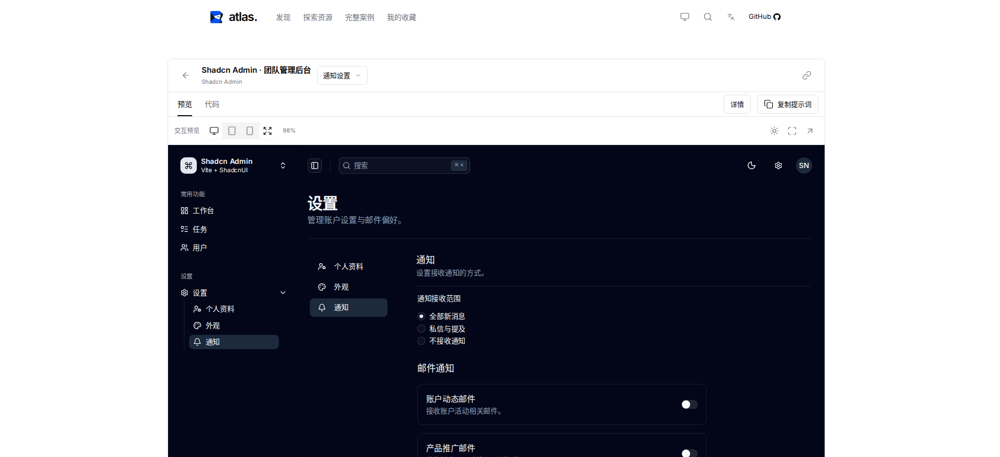
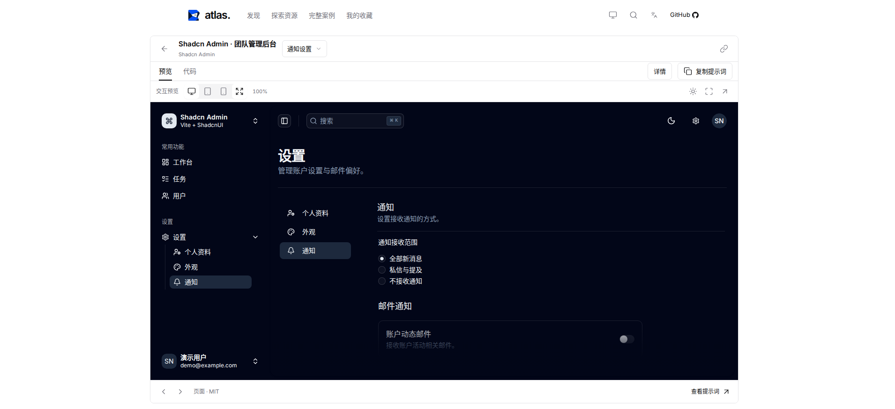
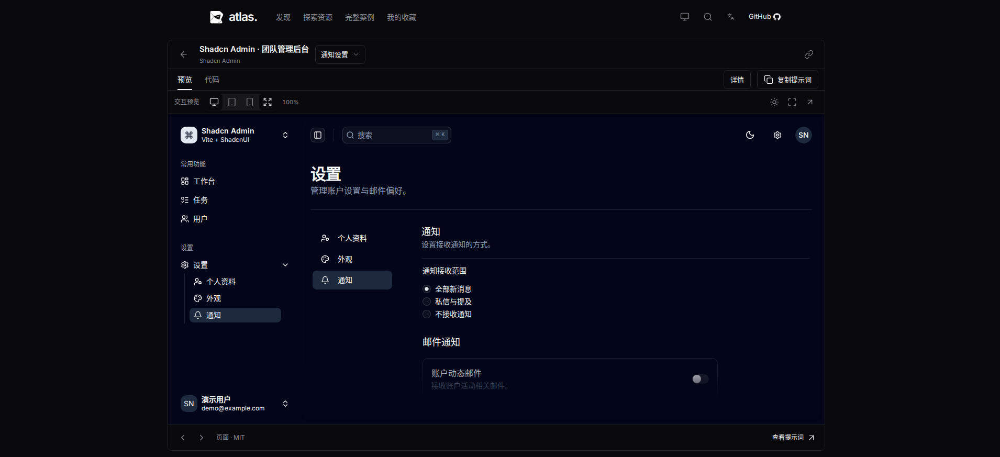
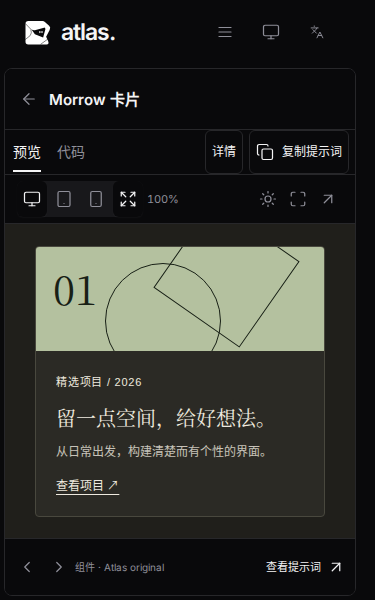
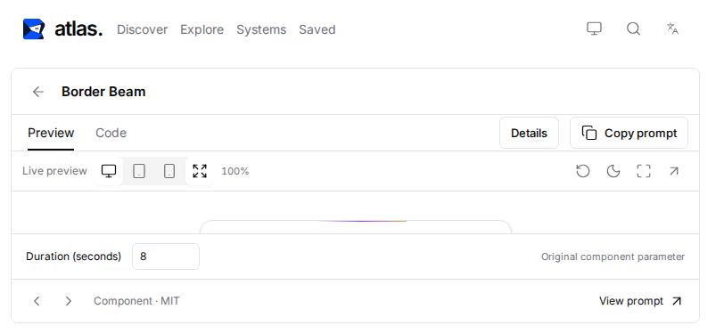
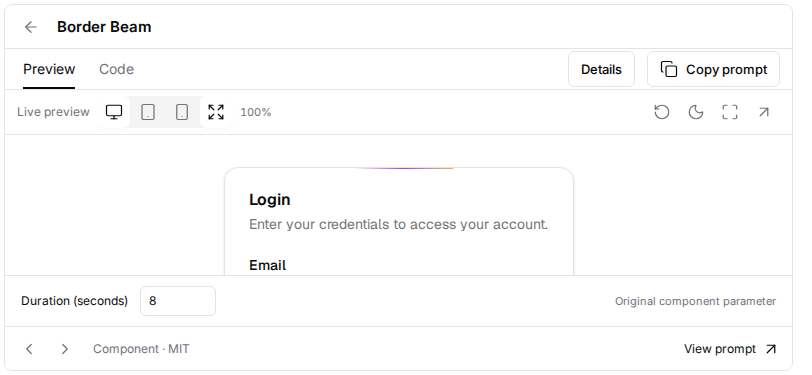

# 详情查看器按窗口适配

本页保留窗口适配阶段的验收快照；后续[组件清晰度改进](../component-clarity/README.md)将自动模式扩展为全部资源的响应式视口，并合并宽屏工具栏。

用户反馈：打开 Shadcn Admin 通知设置并选择“适应画布”后，仍需要向下滚动外层页面。基线为 `bae1722`。

原有实现按宽度缩放页面，并通过原始比例撑高外层查看器；后写的 `height:auto` 覆盖又取消了窗口高度约束。1910×873 窗口实测外层页面高 1141px，底部操作在 1115.75px，落在窗口之外。仅处理小组件不超过 100% 不能修复页面/案例的这个问题。

现在查看器先为导航、标题、工具栏和底部操作保留空间，预览区使用余下高度。页面/案例自动模式以预览容器的实际宽高、scale=1 重新排版，保持正常字号；组件、区块和手动设备模拟则同时考虑可用宽高并保持比例，小组件不放大。实际尺寸模式、说明和源码在各自区域内滚动。

手机自动模式也直接使用实际预览容器宽高、scale=1。长页面允许在 iframe 内滚动，外层查看器和底部操作始终留在窗口内。先前固定 480/528px 高度及短屏外层滚动的规则由此替代。

## 同一窗口的实测

| 1910×873，通知设置 | 修复前 | 修复后 |
| --- | --- | --- |
| 外层页面高度 | 1141px | 873px |
| iframe 显示区域 | 1254×783.75px | 1254×593px |
| 底部操作位置 | 1115.75px，窗口外 | 860px，窗口内 |
| 页面预览缩放 | 98% | 100%，响应式视口 |

[基线尺寸](before-metrics.json)与[最新响应式尺寸](metrics.json)。下列前后图片使用相同窗口、语言、预览主题和外层亮色主题：

与用户截图一致的中文暗色场景：

手机短屏保持正常字号和内部滚动：

## 验证方法

断言同时检查文档高度、查看器边界、底部操作位置、画布边界和 iframe 原生宽高，避免只隐藏滚动条却裁掉内容。覆盖 1910×873、1440×655、1440×600、1273×582（150% 缩放后的等效 CSS 窗口）及 1024×500；响应式验收另覆盖手机/平板、中英文、明暗主题。

原先要求外层页面变长、固定组件舞台高度或固定页面视口宽度的测试，已更新为上述窗口适配约束。原始尺寸仍作为显式模式验证；手动设备、全屏、主题、详情返回和输入保留继续执行回归。手机测试实际滚动到通知表单底部保存设置，核对持久化值，并分别验证说明和源码内部滚动。

`npm run verify` 全部通过：严格检查、11 项单元测试、生产构建、121 项浏览器测试（Chromium 111 项、Firefox/WebKit 各 5 项）及 1 项隔离开发综合测试。启动脚本 gzip 合计 186,929 字节，低于 190,000 字节预算。未升级依赖。本地 WebKit 使用临时补齐的运行库并只跳过系统缓存依赖探测，所有浏览器流程实际执行；CI 仍按正常方式安装浏览器依赖。

## 矮窗口审核修复

审核确认手机横屏仍有边界缺陷：带参数的 Border Beam 在 812×375 窗口仅剩 47px 预览高度，812×320 时预览区为 0px。高度不超过 480px 时，现在收起站点导航，保留查看器返回按钮，压缩标题和底部留白；退出详情后站点导航恢复。

以下高度为 Chromium 实测：

| 窗口 | 修复前预览高度 | 修复后预览高度 |
| --- | --- | --- |
| 812×320 | 0px | 85px |
| 812×375 | 47px | 140px |
| 1440×400 | 69px | 165px |

Chromium、Firefox、WebKit 均实际验证了画布和底部操作在窗口内、iframe 内邮箱输入、参数修改生效及返回列表后恢复站点导航。

