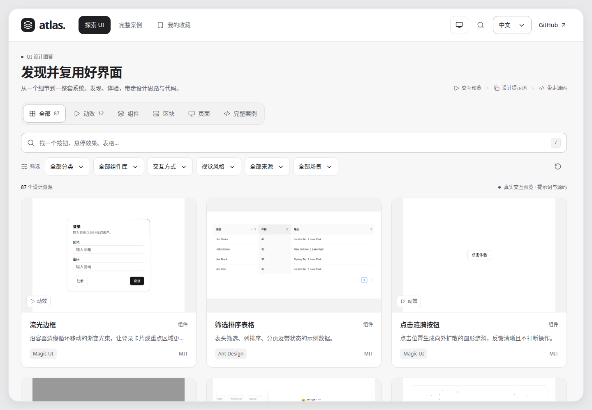
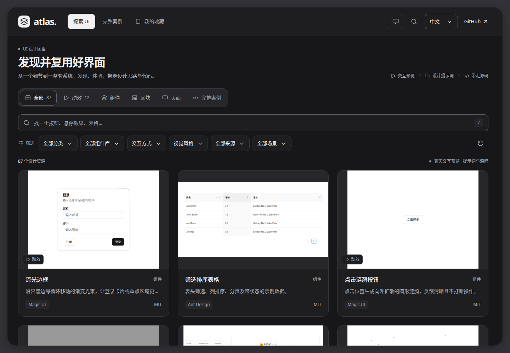
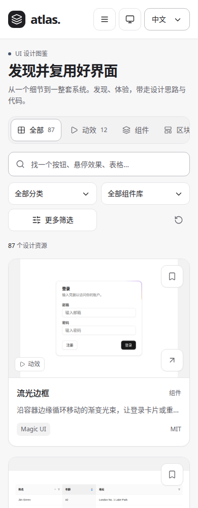

# 图鉴外层 UI：映序设计基线的业务映射

## 来源与边界

采用用户提供的映序 UI 复现资料，基线为 `f775817076202ee9a415a069a2c141fba3257b43`，整合版本为 `b3cc662ce5cfe7947d6e5cec84ae54719f5d1062`。原始参数与实际公共组件保存在 [vendor/yingxu-ui](../../vendor/yingxu-ui/ATTRIBUTION.md)，原文文件保持不变并由 SHA-256 校验。

本次目标是让用户找到一个 UI，直接体验，阅读对应设计说明，再复制提示词或实际代码。保留资源墙和快速浏览弹层，沿用现有内容、hash 链接、收藏、双语及本地独立预览。映序的制作流程、业务侧栏、预算模型和品牌图形不属于图鉴的业务映射。

## 页面结构与组件映射

| 图鉴任务 | 页面位置 | 采用的实际规则或组件 |
| --- | --- | --- |
| 找资源 | 唯一页头、资源类型、搜索、筛选、资源墙 | 32/20/16/14/12px 字级；中性阅读面；资源类型使用真实 SelectionGroup 完整轮廓 |
| 快速体验 | 大弹层左侧真实预览，底部相邻资源导航 | 原生 dialog；桌面内部滚动；移动端纵向重排；ScrollLock 管理嵌套拥有者 |
| 理解与复用 | 右侧名称、介绍、说明、提示词、关联及代码 | 16px 阅读正文；真实 SelectionGroup 下横条；完整 tab/tabpanel 键盘行为 |
| 选择分类、组件库或源文件 | 筛选、语言、预览页面、提示词层级、源码文件 | 真实 StudioSelect；保留单一原生表单值、reset、键盘和浮层自动避让 |
| 执行导航与显示命令 | 手机导航和图鉴显示模式菜单 | 真实 StudioMenu；Menu 执行命令，Select 保存字段值 |
| 切换显示模式 | 图鉴显示模式菜单 | 沿用原始 light/dark 与 slate tokens，黑白主操作；跟随系统/浅色/深色，独立存储与跨标签页同步 |
| 返回继续找 | 关闭预览、浏览器后退 | 恢复桌面内容区或手机文档的实际滚动位置、筛选、加载数量与触发焦点 |

## 固定设计语言

- 画布、面板、正文、辅助文字、边界和状态使用原始语义变量；图鉴外层 CSS 不另建配色表。
- 采用原始最终覆盖：面板 16px、控件 11px 圆角。桌面最大 1680px、26px 外框圆角，内部独立滚动；手机恢复文档滚动。
- 黑白主导航和主按钮不随焦点色染色；slate 色只用于焦点、标记等少量提示。
- 常规交互控件至少 44px，图标约 16–20px。移动筛选以分类与组件库为常用入口，其余条件原地展开；分享链接中的有效条件仍会恢复。
- 连续选择复用原始 Motion 弹簧、速度形变及减少动态效果处理。移动的是标记，文字字重和控件尺寸保持稳定。
- 外层明暗与演示主题独立。演示依然在同源 iframe 中保留各自组件库、样式与 Provider。

## 工程实现

[shell/controls.tsx](../../shell/controls.tsx) 为现有原生 catalog 渲染器接入真实 React 组件，不重写注册表与路由。选择组挂载点在页面更新时保留，使 Motion 状态可以连续；选择器在其浮层宿主被替换前卸载，避免原生 dialog 内 portal 节点被提前删除。关闭后快速重开同一个 dialog 时，旧 close 事件不释放新的滚动锁。

根项目增加锁定的 React、Radix、Motion 与构建依赖。构建器将外层打包为同源 `atlas-shell.js/css`，保留相对资源与 Pages 子路径。两套收录演示继续独立构建。源码检查包含设计基线校验和外层 TypeScript 检查。

本次也修正两处与接入相关的交互：详情键盘焦点定位到当前页签；UI Market 初始化仅应用一次 URL 主题，避免之后的用户切换被初始化覆盖。

## 验收与复现

```sh
npm ci
npm run setup:examples
npm run check
npm run build
npm test
node scripts/serve.mjs --dist --base=/ui-design-atlas/
# 在另一个终端记录实际浏览器证据
node scripts/capture-shell.mjs
```

交互测试覆盖原有资源浏览和复用流程，以及真实 Select 的 FormData/reset、dialog 内浮层、Escape 和焦点恢复、选择标记连续性、页签键盘规则、减少动态效果、明暗持久化与跨标签页同步、实际滚动恢复、44px 控件和手机筛选。

截图和录屏位于 [yingxu-shell](./yingxu-shell/)；`verification.json` 记录 1982/1440/390px、明暗模式与浏览器错误检查。这些是本地真实演示的浏览器画面，演示数据为既有合成数据。

### 浏览效果

浅色首页：



深色首页：



手机首页：



[真实选择与复用流程录屏](./yingxu-shell/selection-interaction.webm)
